<div align="center">


### 내 관심사만 골라, 매일 아침 한 통으로

AI가 그날의 기사를 읽고 분야별로 중요한 소식만 골라 정리한 뉴스레터를<br/>사이트와 메일로 보내는 서비스입니다.

**[🔗 newpick.hyeoniverse.com](https://newpick.hyeoniverse.com)**


<br/>


<table>
  <tr>
    <td width="68%">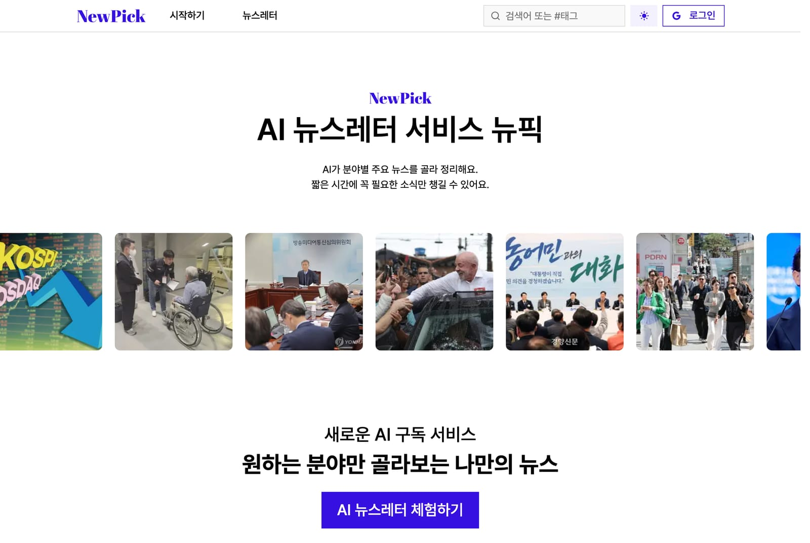</td>
    <td width="32%">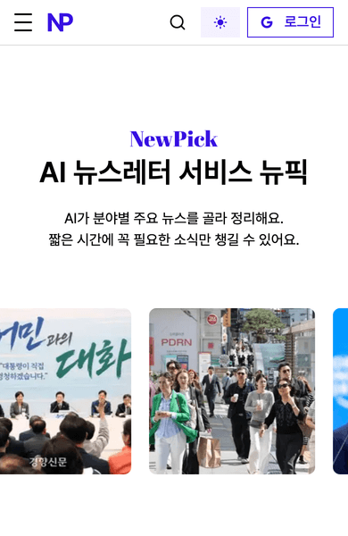</td>
  </tr>
</table>

</div>

| | |
| --- | --- |
| **무엇** | 네이버 뉴스를 매시 모아, 매일 아침 분야(IT · 경제 · 정치 · 사회 · 세계 · 생활)마다 AI가 쓴 뉴스레터를 발행하고, 구독자마다 관심사 · 취향에 맞춘 메일 한 통을 보냅니다 |
| **v1** (2024.12 – 2025.02) | 프로그래머스 데브코스 5인 팀 프로젝트 (FE 2 · BE 3). 프론트엔드 · 기획 · 로그인 담당 |
| **v2** (2026.10 – ) | 혼자 이어받아 **풀스택**으로 다시 설계 · 운영. 웹 · api · AI 파이프라인 · 배포 · 리팩토링 |

## 목차

[한눈에](#한눈에) · [보안](#보안) · [화면 둘러보기](#화면-둘러보기) · [주요 기능](#주요-기능) · [동작 흐름](#동작-흐름) · [운영 숫자](#운영-숫자) · [AI 설계](#ai-설계) · [아키텍처](#아키텍처) · [데이터 모델](#데이터-모델) · [v1 → v2](#v1--v2-팀-프로젝트를-운영-서비스로) · [모바일 성능](#모바일-성능-292) · [운영하며 해결한 문제](#운영하며-해결한-문제) · [개발](#개발)

## 한눈에

- 🔐 **보안을 기본값으로, 그리고 직접 점검**: 모든 API를 로그인 필요로 두고 공개 · 관리자 API를 열어 주는 방식(기본 거부), 라우트 **120개**의 권한을 테스트로 고정. 세션 토큰은 httpOnly 쿠키 · 서버에는 해시만. 배포 구조를 따라 점검해 **취약점 4개를 찾아 고침**(요청 제한이 전체 공용 · 로그인 CSRF · SSRF · 이미지 고정). 의존성 취약점 api **171 → 0** · 웹 **35 → 0** → [보안](#보안)
- 🗞️ **혼자 만들고 매일 운영하는 서비스**: 매시 기사를 모으고(최근 30일 **35,361건**), 매일 아침 6개 분야 뉴스레터를 AI가 써서 발행합니다(30일 **144편**). 수집 · 요약 · 메일은 예약 작업으로 돌고, 실패는 대시보드와 Sentry로 봅니다.
- 💸 **AI 비용을 설계로 줄임**: 모든 기사를 비싼 모델에 넣지 않고 가벼운 모델로 먼저 고른 뒤 쓰기, 맞춤 글은 무료 할당의 오픈 모델 우선 + 하루 비용 상한. 30일 AI 비용 **$11.15**(하루 약 $0.37).
- 🧹 **두 번의 리팩토링**: 팀 코드를 측정 → 안전망 → 정리 순으로. 순환 import · 서로 import하는 모듈 0, api `strict: true` · `any` 0, 테스트 0 → api **445** · 웹 **213** · E2E.
- ⚡ **모바일 성능을 재서 원인부터**: 공개 화면 모두 휴대폰 LCP **2.1초 이하**(실제로 느리게 잰 값), Lighthouse 권장사항 **100**. 상세는 서버(UTC)와 브라우저(KST)의 날짜 차이로 화면 전체를 다시 그리던 것을 찾아 LCP 4.6 → 1.0초.

## 보안

혼자 운영하는 서비스라 **사고가 나면 막아 줄 사람이 없다**는 전제로, 기본값을 안전한 쪽에 두고 그 규칙을 테스트 · 검사로 잠갔습니다. 자세한 설계 · 근거 · 확인 방법은 **[보안 설계 문서(docs/security.md)](docs/security.md)** 에 있습니다.

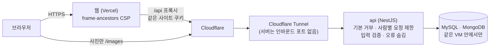

| 영역 | 요약 |
| --- | --- |
| **인증 · 세션** | 비밀번호 없이 Google 로그인 + OAuth `state`(로그인 CSRF). 토큰은 httpOnly · Secure · SameSite 쿠키, 서버에는 SHA-256 해시만, 갱신마다 교체 · 기기별 로그아웃 |
| **권한** | 모든 라우트가 로그인 필요(기본 거부), 공개 · 관리자는 하나씩 열어 줌. 관리자는 매 요청 DB 확인, 라우트 **120개**의 정책을 테스트로 고정 |
| **요청 폭주** | 요청 횟수 제한을 로그인한 사용자 · 실제 접속자 IP(`CF-Connecting-IP`)로, 인증 코드는 5번 틀리면 다시 |
| **입력 · 출력** | 전역 입력 검증(모르는 칸 400), 문자열로 만드는 SQL 0곳, AI가 쓴 본문은 DOMPurify(XSS), 500은 내부 정보를 숨김 |
| **SSRF** | 사진 서버는 허용한 출처 · https · 정해진 폭만, 리디렉션도 요청 전에 검사 |
| **인프라** | 인바운드 포트 없음(Tunnel), DB는 VM 안에서만, 배포 키는 스크립트 하나만 돌게 묶음, 비밀값은 켜질 때 검사 |
| **공급망** | 의존성 취약점 api **171 → 0** · 웹 **35 → 0**(개발 도구 포함), 설치 스크립트 허용 목록, 운영 이미지 해시 고정 |
| **개인정보** | 최소 수집 · 처리방침을 실제 기준으로 · 탈퇴하면 한 번에 파기 |

### 직접 점검해 찾고 고친 것 ([#332](https://github.com/hyeoniverse/newpick/pull/332))

"이 방어가 **이 배포 구조에서** 실제로 동작하는가"를 요청이 들어오는 길을 따라 확인해, 코드만 보면 맞아 보이던 방어 넷이 비어 있던 것을 찾아 고쳤습니다.

1. **요청 횟수 제한이 사실상 전체 공용**: api가 Tunnel 뒤라 `req.ip`가 늘 터널 컨테이너 하나 → 사용자 · 실제 접속자 IP로
2. **Google 로그인에 `state` 없음**(로그인 CSRF) → 쿠키 기반 state
3. **사진 서버 SSRF**: 리디렉션을 따라간 뒤에 검사 → 다음 주소를 요청하기 전에 검사
4. **운영 이미지 `latest`** → 판 · 해시 고정

2번은 단위 테스트를 통과했는데 실제 로그인에서 실패했습니다(state 확인 결과를 passport-oauth2가 PKCE `code_verifier`로 착각). 그 뒤로 **보안 수정은 실제 흐름으로 끝까지 확인한다**를 규칙으로 삼았습니다. 원인 · 확인 과정은 [보안 설계 문서의 점검 기록](docs/security.md#14-점검-기록)에.

## 화면 둘러보기

### 📰 뉴스레터 목록 · 검색 · 태그

오늘 발행한 분야별 뉴스레터가 맨 위 큰 배너로 넘어가고, 그 아래로 지난 뉴스레터가 이어집니다. 관심사 · 기간 · 자주 나온 태그로 거르고, 머리글의 검색칸으로 제목 · 본문을 찾습니다(MySQL 전문 검색, 한국어 2글자씩 나누는 ngram). 태그 화면에서는 그동안 쓰인 태그를 많이 쓴 순 · 최근 순으로 봅니다.

<table>
  <tr>
    <td width="68%">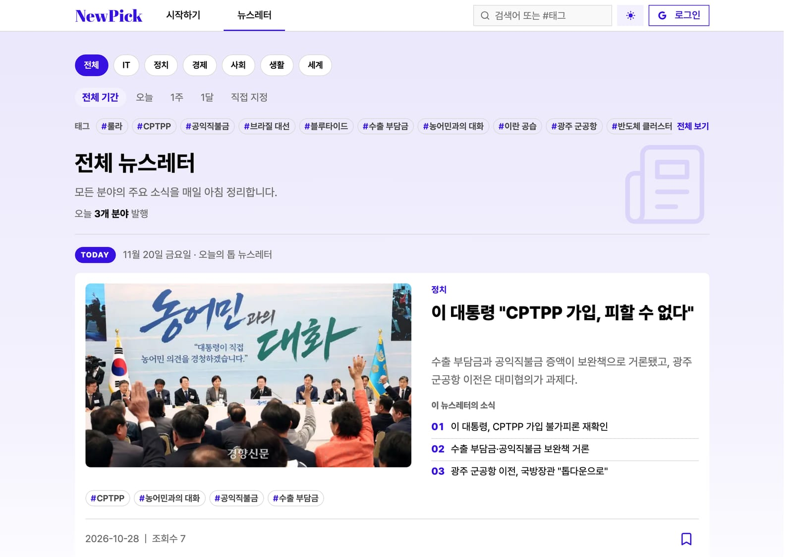</td>
    <td width="32%">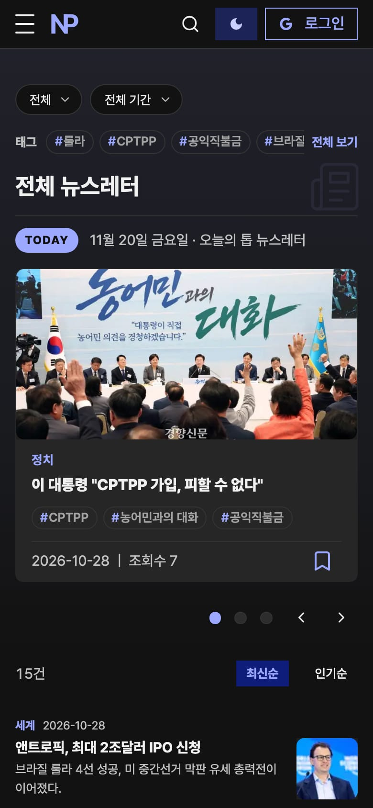</td>
  </tr>
</table>

<table>
  <tr>
    <td width="50%">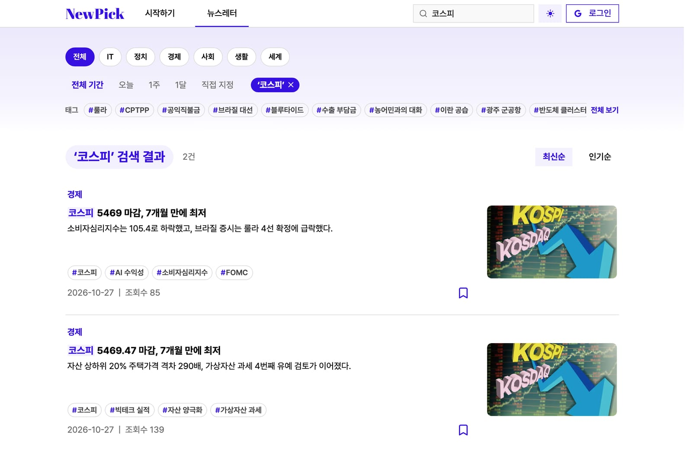<p align="center"><sub>검색 결과 · 검색어 강조</sub></p></td>
    <td width="50%">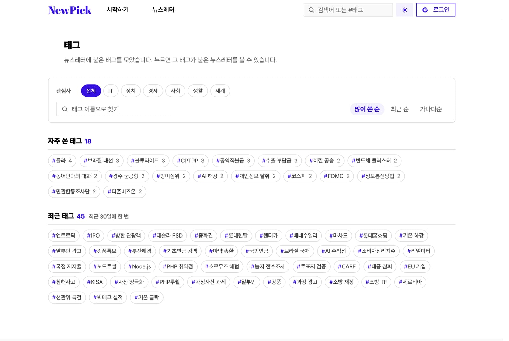<p align="center"><sub>태그 전체 · 분야별 · 많이 쓴 순</sub></p></td>
  </tr>
</table>

### 📖 뉴스레터 상세 · 형광펜

한 편에 분야의 주요 소식 최대 3개와 오늘 아침 속보가 담깁니다. 소식마다 내용에 맞는 모양(지표 카드 · 날짜별 경과 · 문답 · 인용 · 해설 · 단신)으로 그리고, 핵심 문장에는 AI가 형광펜을 긋습니다. 읽는 사람은 문장을 골라 **스크랩 · 메모**하고, 궁금한 소식은 **후속 지켜보기**로 이어지는 소식을 메일로 받습니다.

<table>
  <tr>
    <td width="50%"><p align="center"><sub>상세 · 오른쪽에 지금 인기 뉴스레터 TOP 5</sub></p></td>
    <td width="50%">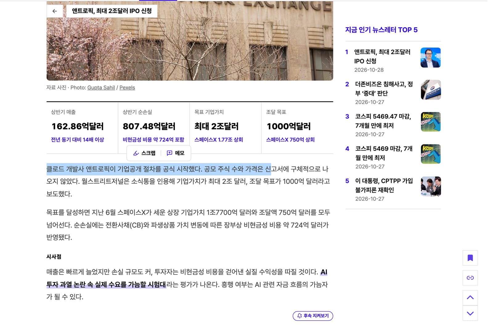<p align="center"><sub>문장을 고르면 스크랩 · 메모, 아래는 AI가 그은 핵심 문장</sub></p></td>
  </tr>
</table>

<table>
  <tr>
    <td width="50%"></td>
    <td width="50%"></td>
  </tr>
</table>

### ✉️ 맞춤 메일 · 마이페이지

구독자마다 메일이 한 통씩 다릅니다. 고른 분야를 모으되 북마크 · 스크랩으로 계산한 **취향 점수**로 소식 순서를 바꾸고, 사람마다 제목 · 브리핑을 따로 쓰고, 뉴스레터에 안 실린 추천 기사 · 팔로우한 태그 소식 · 지켜보던 소식의 후속을 덧붙입니다. 받은 메일은 마이페이지에서 받은 그대로 다시 볼 수 있고, 폴더로 정리합니다.

<table>
  <tr>
    <td width="50%">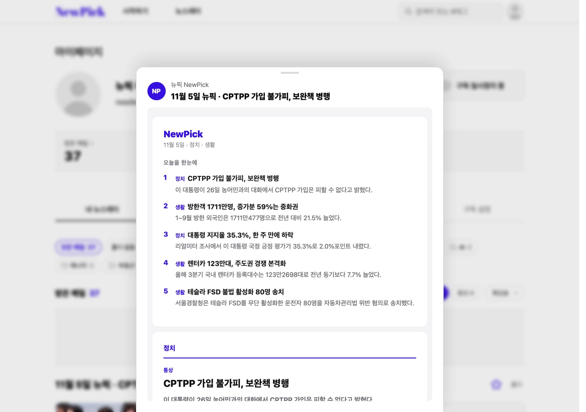<p align="center"><sub>받은 메일 다시 보기 · 오늘의 소식 한눈에</sub></p></td>
    <td width="50%">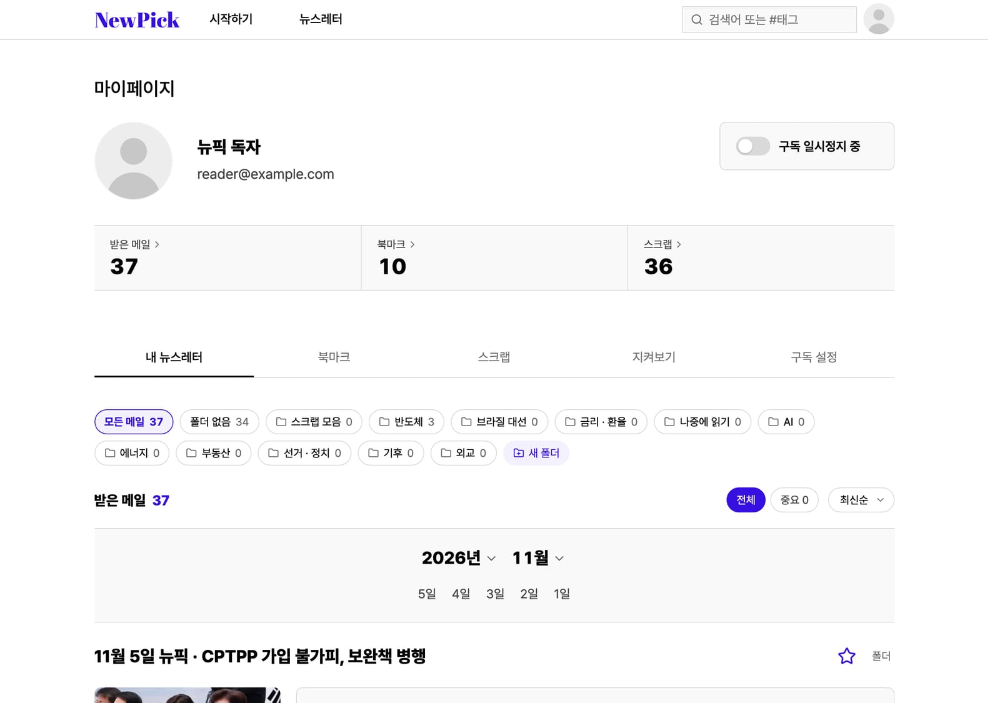<p align="center"><sub>마이페이지 · 받은 메일 · 폴더 · 달별 바로 가기</sub></p></td>
  </tr>
  <tr>
    <td width="50%">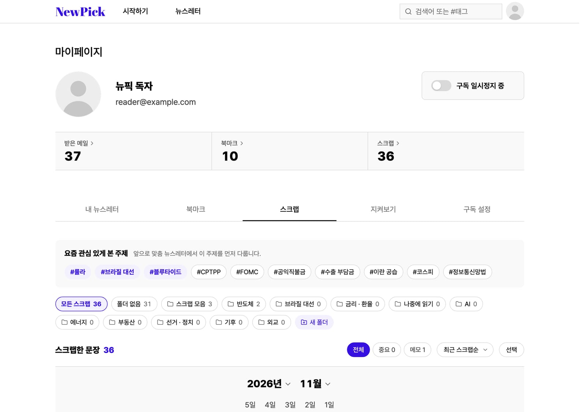<p align="center"><sub>스크랩한 문장 · 요즘 관심 있게 본 주제(맞춤 메일에 반영)</sub></p></td>
    <td width="50%">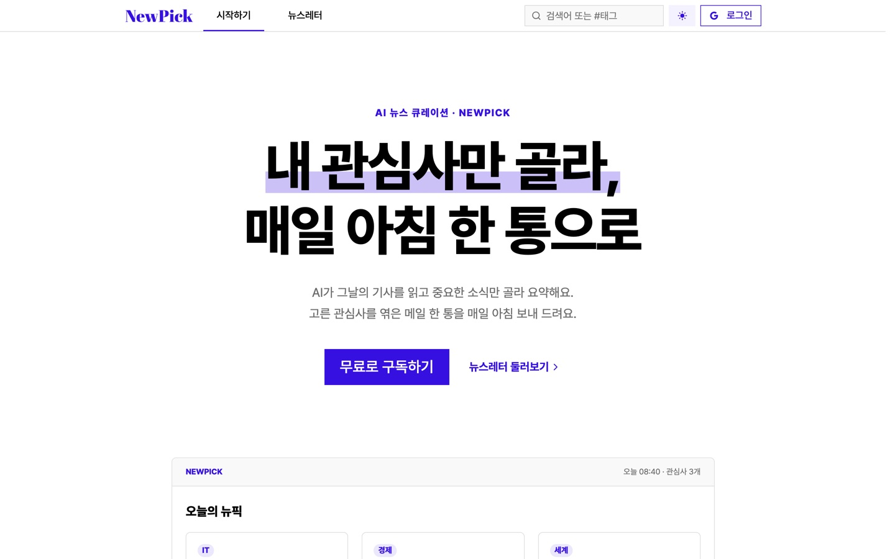<p align="center"><sub>시작하기 · 서비스 소개</sub></p></td>
  </tr>
</table>

### 🛠️ 관리자

첫 화면은 고른 기간의 숫자(수집한 기사 · 발행한 뉴스레터 · AI 비용 · 메일 받은 사람)와 예약 작업입니다. 메일 받은 사람은 기간 동안 받은 서로 다른 사람 수이고, 보낸 메일 수는 따로 셉니다. 예약 작업(수집 · AI 요약 · 메일)의 실행 기록을 보고, 지금 실행하거나 시각을 바꿉니다. AI 호출 기록 · 비용, 구독 · 발송 · 방문 통계, 페이지 히트맵, 뉴스레터 고치기 · 다시 쓰기, 태그 합치기도 여기서 합니다.

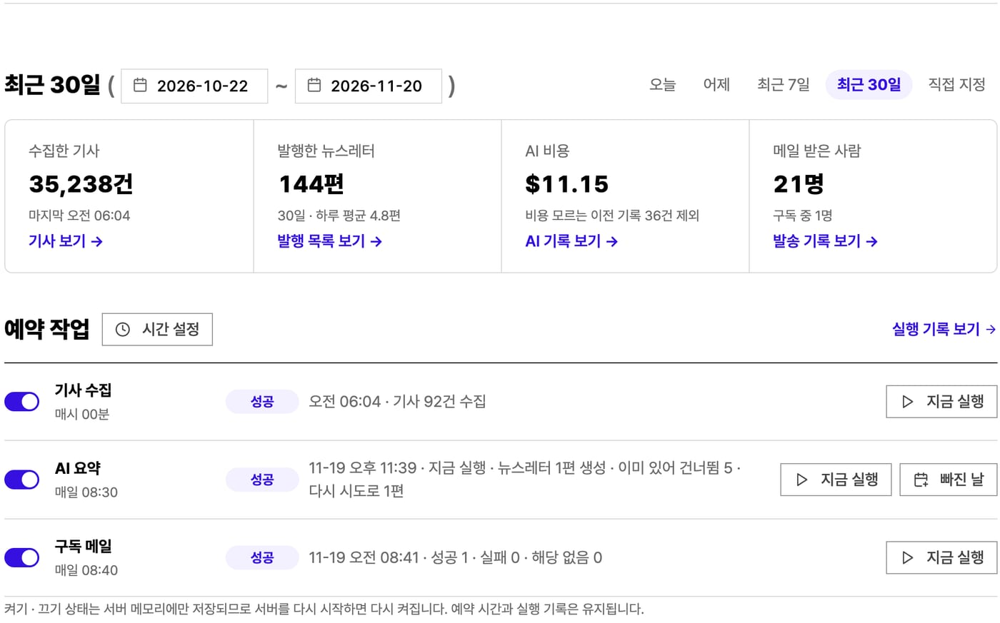

> 화면의 이름 · 메일은 예시 값으로 바꿨습니다.

## 주요 기능

| 기능 | 내용 |
| --- | --- |
| **분야별 AI 뉴스레터** | 매일 08:30, 분야마다 주요 소식 최대 3개 + **오늘 아침 속보**. 소식마다 내용에 맞는 템플릿(지표 카드 · 날짜별 경과 · 문답 · 인용 · 해설 · 단신), 핵심 문장 형광펜, 엇갈린 주장, 관전 포인트. 소식 사진은 원출처 기사의 사진, 없으면 Pexels · Unsplash에서 찾은 사진(출처 표시) |
| **맞춤 메일** | 구독자마다 한 통: 고른 분야 + 북마크 · 스크랩으로 계산한 **취향 점수**로 소식 순서를 바꾸고, 사람마다 쓴 제목 · 브리핑, 뉴스레터에 안 실린 **추천 기사**, **팔로우한 태그** 소식, **지켜보던 소식의 후속**을 붙임. 원클릭 수신 거부 |
| **읽기 도구** | 문장 형광펜 · 메모 · 폴더(스크랩), 북마크, 소식 **후속 지켜보기**, 태그 팔로우 · 검색, 받은 메일 다시 보기, 다크 모드 |
| **관리자** | 예약 작업 대시보드(수집 · 요약 · 메일 실행 기록, 지금 실행, 시각 바꾸기, 빠진 날 다시 만들기), AI 기록 · 비용, 구독 · 발송 · 방문 통계, 페이지 히트맵 |
| **사진이 깨져도** | 원래 사진 → 뉴스레터 키워드로 찾은 Pexels 사진 → 기본 그림 순으로 대신 보입니다. 사진은 api 서버가 줄여(sharp · WebP) Cloudflare 가장자리에서 캐시합니다 |

## 동작 흐름

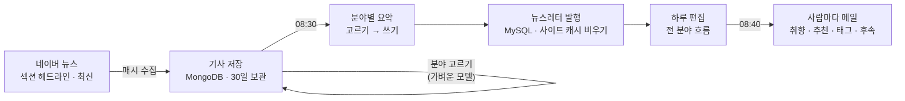

1. **매시 수집**: 네이버 뉴스 섹션의 헤드라인 · 최신 기사를 모아 MongoDB에 둡니다(30일 뒤 저절로 지움). 기사마다 가벼운 모델이 분야를 고릅니다.
2. **08:30 요약**: 분야마다 그날 기사를 고르고(가벼운 모델) 씁니다(Claude). 쓴 뉴스레터는 MySQL에 저장하고 사이트 캐시를 비워 바로 보이게 합니다.
3. **하루 편집**: 여러 분야를 가로지르는 흐름 · 같은 사건을 묶어, 맞춤 메일의 첫머리로 씁니다.
4. **08:40 메일**: 구독자마다 관심사 · 취향 · 팔로우 · 지켜보기를 반영해 한 통씩 만들어 보냅니다.

예약 시각은 관리자 화면에서 바꿀 수 있고(순서 검사), 작업마다 실행 기록(성공 · 일부 실패 · 실패와 이유)이 남아 대시보드에서 봅니다.

## 운영 숫자

최근 30일(2026-10-22 ~ 11-20), 관리자 대시보드 기준입니다.

| 항목 | 값 |
| --- | --- |
| 수집한 기사 | **35,361건** (매시, 네이버 뉴스 섹션 헤드라인 · 최신) |
| 발행한 뉴스레터 | **144편** (하루 평균 4.8편, 6개 분야) |
| AI 비용 | **$11.15** (하루 약 $0.37, 비용을 기록하기 전의 AI 기록 36건 제외) |
| 예약 작업 | 수집 매시 00분 · AI 요약 매일 08:30 · 구독 메일 매일 08:40 |

## AI 설계

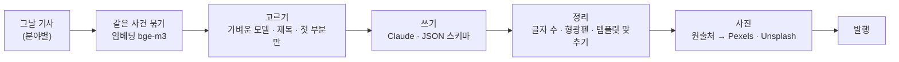

| 결정 | 이유 |
| --- | --- |
| **고르기 → 쓰기 2단계** | 모든 기사를 비싼 모델에 넣지 않습니다. 가벼운 모델이 묶음마다 제목 · 첫 부분만 보고 점수(파급 · 새로움 · 관심사 · 후속)를 매기고, 기본 모델은 고른 소식의 대표 기사만 받아 씁니다 |
| **같은 사건 묶기** | 임베딩(bge-m3)으로 같은 사건을 다룬 기사를 한 묶음으로. 다른 언론사 기사를 먼저 보내 엇갈린 주장을 찾게 합니다. 임베딩이 안 되면 제목으로만 묶고 멈추지 않습니다 |
| **JSON 스키마 + 정리 단계** | 응답을 스키마로 받고, 코드가 글자 수 · 형광펜 개수 · 따옴표 · 템플릿 요소를 다시 맞춥니다. 모델 출력이 흔들려도 화면 · 메일 모양이 깨지지 않습니다 |
| **오픈 모델 우선 + 비용 상한** | 맞춤 글 · 후속 판정은 무료 할당의 오픈 모델(Workers AI)로 쓰고, 안 되면 Claude로 넘기되 **하루 비용 상한**을 둡니다. 뉴스레터 본문처럼 품질이 중요한 곳만 Claude |
| **실패해도 나머지는 계속** | 분야 하나가 실패해도 다른 분야는 발행하고, 실패한 분야는 잠시 뒤 다시 시도합니다. 실패해도 그때까지 쓴 토큰 · 비용은 기록합니다 |
| **동작 고정 테스트** | 프롬프트 · 스키마를 고칠 때 가짜 응답으로 바꾸기 전 · 후 출력을 바이트 단위로 비교합니다 (Claude 호출 없이) |

## 아키텍처

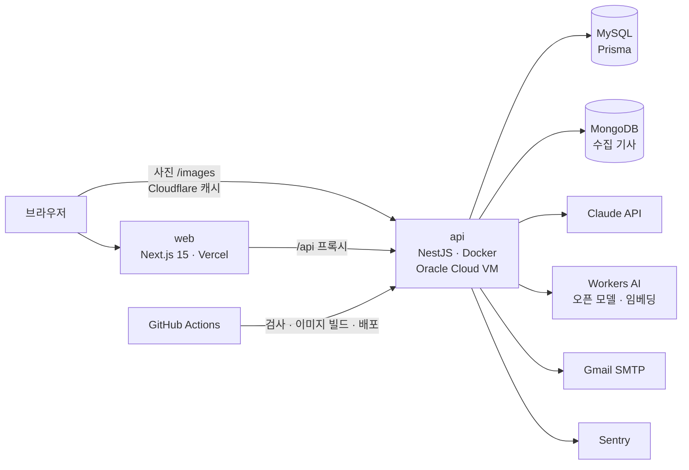

| 영역 | 기술 |
| --- | --- |
| web | Next.js 15 (App Router · ISR), React 19, TypeScript, Tailwind CSS v4, React Query, zustand |
| api | NestJS 10, Prisma (MySQL), Mongoose (MongoDB), jsdom (수집 · HTML 정리), sharp (사진 줄이기), nodemailer |
| AI | Claude (요약 · 편집), Cloudflare Workers AI (오픈 모델 · 임베딩) |
| 인프라 | Vercel, Oracle Cloud VM + Docker, Cloudflare Tunnel, GitHub Actions (CI · 자동 배포), Sentry |
| 품질 | Vitest · Jest · Playwright, ESLint 9 · Prettier, madge (순환 import), 화면 · 응답 비교 도구 |
| 저장소 | npm workspaces 모노레포 (`apps/web` · `apps/api` · `packages/shared`) |

### 왜 이렇게 골랐나

| 선택 | 이유 |
| --- | --- |
| **정적 화면 + 10분 재생성(ISR), 발행 때 바로 다시 만들기** | 뉴스레터는 하루 한 번 바뀌고 누구에게나 같습니다. 매 요청마다 api를 부르지 않고, 발행 · 수정 · 삭제 때 api가 사이트 캐시를 비웁니다 |
| **MySQL + MongoDB** | 사용자 · 뉴스레터 · 북마크처럼 서로 이어진 데이터는 MySQL(Prisma). 매시 쌓였다가 뉴스레터를 쓰고 나면 필요 없어지는 원문 기사는 MongoDB에 두고, 30일이 지나면 저절로 지웁니다(TTL 인덱스) |
| **Oracle Cloud 무료 VM + Docker** | 예약 작업(수집 · 요약 · 메일)이 늘 떠 있어야 해서 서버리스보다 상시 서버가 맞고, 혼자 운영하는 비용을 0에 가깝게. 이미지는 GitHub Actions가 만들어 배포합니다 |
| **모노레포 + 공유 패키지** | api 응답 모양 · 오류 code · 분야 목록을 웹이 손으로 다시 적다 어긋난 적이 있어, 한곳에 두고 어긋나면 타입 오류가 나게 했습니다 |
| **api 요청은 웹의 `/api` 프록시로만** | 로그인 쿠키가 프론트 도메인에 저장돼 다른 도메인 쿠키 문제가 없고, 토큰 갱신을 한곳(`api/client.ts` · middleware)에서 합니다. 쿠키가 필요 없는 사진(`/images/i.webp`)만 브라우저가 api에서 바로 받아 Cloudflare 가장자리 캐시를 씁니다 |

## 데이터 모델

MySQL 23개 테이블 가운데 서비스의 뼈대입니다. 운영 기록(예약 작업 실행 · AI 호출 · 하루 편집 · 방문 · 구독 변화 · 메일 계획)은 따로 있습니다.

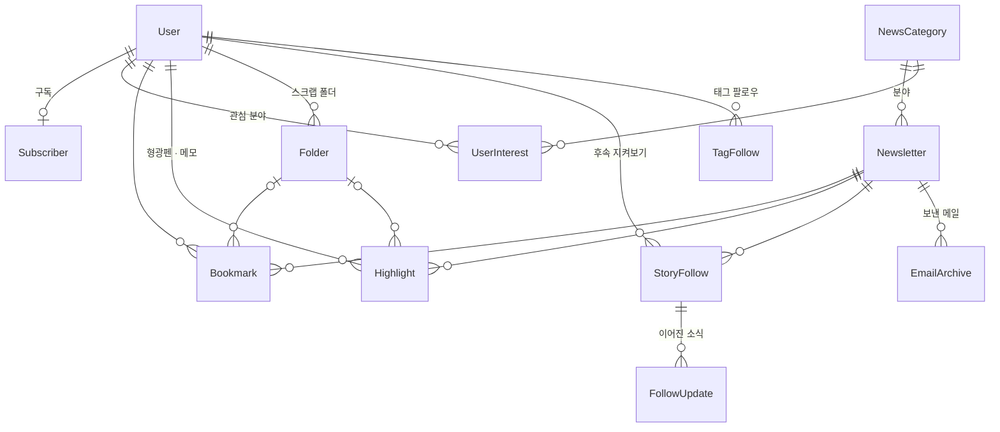

- 원문 기사는 MongoDB(수집 · 분야 고르기 · 30일 보관), 뉴스레터에는 쓴 기사의 링크만 남깁니다.

## v1 → v2: 팀 프로젝트를 운영 서비스로

팀 프로젝트가 끝난 코드를 이어받아, 기능을 더하기 전에 **재고(측정) → 안전망 → 정리** 순으로 두 번 리팩토링했습니다. 모든 단계는 이슈로 계획하고 PR마다 바꾸기 전 · 후를 비교했습니다(화면 23개 × 라이트 · 다크 · 휴대폰, api 응답 44개, AI 출력 바이트).

<details>
<summary><b>1차 (#4)</b>: 기준선 측정 · 보안 · 배포 · 테스트</summary>

| | 전 | 후 |
| --- | --- | --- |
| api 의존성 취약점 (critical · high) | 6 · 108 | 0 · 11 |
| 테스트 | 0개 (실패하는 빈 틀) | api · 웹 단위 · E2E, PR마다 CI |
| 렌더링 | 모든 페이지 동적 | 정적 + 10분 재생성 (새 뉴스레터가 나오면 바로 다시 만듦) |
| 배포 | 없음 | Vercel + Oracle 무료 VM, main에 들어가면 자동 배포 |
| 스타일 | styled-components | Tailwind v4 (화면 비교로 모양 그대로 옮김) |

</details>

<details open>
<summary><b>2차 (#202)</b>: 구조 · 타입 · 상수 · 도구</summary>

| | 전 | 후 |
| --- | --- | --- |
| 공유 타입 | 웹이 api 응답 · 오류 code를 손으로 다시 적음 | 공유 패키지 하나, 어긋나면 타입 오류 |
| 큰 파일 (하는 일 단위로 나눔) | 뉴스레터 쓰기 1047줄 · 예약 작업 916줄 · 마이페이지 503줄 · 날짜 고르기 496줄 | 200 · 180 · 93 · 10줄 (나머지는 하는 일별 파일) |
| 환경 변수 | 40곳에서 직접 읽음, 시작 검사 3개 | 설정 파일 한 곳, 필수 · 형식 · 짝 검사 |
| 모듈 경계 | 서로 import하는 모듈 7쌍, 순환 import 3개 | **0 · 0** (CI가 막음) |
| api 타입 | `strictNullChecks` · `noImplicitAny` 꺼짐 | `strict: true`, `any` 0곳 |
| 도구 | 두 앱의 포맷 · ESLint 판이 다름 | 같은 Prettier · ESLint 9 |
| 겹치는 층 (z-index) | 9999 · 1000 · 1001 · 999 … 숫자 경쟁 | 이름 붙인 층(sticky < header < modal < popover < toast) |
| 테스트 | api 362 · 웹 109 | api **445** · 웹 **213** · E2E 5개 묶음 |

정한 규칙은 lint · 검사 스크립트로 잠가 다시 흐트러지지 않게 했습니다 ([docs/structure.md](docs/structure.md)).

</details>

### 모바일 성능 (#292)

기능이 붙으며 휴대폰 첫 화면이 늦어진 것을 Lighthouse로 재고, **숫자가 큰 원인부터** 하나씩 확인해 고쳤습니다. 운영 사이트, 모바일, 3번 중앙값입니다.

| 화면 | 전 (점수 · LCP) | 지금 (점수 · LCP) | 지금, 실제로 느리게 (LCP) | 원인 |
| --- | --- | --- | --- | --- |
| 홈 | 73 · 7.1초 | **84 · 4.5초** | **2.1초** | 화면 밖 사진까지 처음부터 받음(41장 · 1 MB), 사진이 JS를 기다려 나타남 |
| 목록 | 81 · 5.0초 | **89 · 3.7초** | **1.8초** | 위와 같음 + '직접 지정'에서만 쓰는 달력 코드(75 KB)를 처음부터 받음 |
| 상세 | 82 · 4.6초 | **99 · 1.0초** | **1.8초** | 날짜를 서버(UTC)와 브라우저(KST)가 다르게 그려 하이드레이션이 어긋나, 화면 전체를 다시 그림 |
| 소개 | 84 · 4.1초 | **99 · 1.2초** | **1.8초** | 가장 큰 글자에 걸린 등장 애니메이션 때문에 Chrome이 LCP를 늦게 기록 |

- '점수 · LCP'는 Lighthouse 기본값(느린 휴대폰을 **계산으로 흉내**), '실제로 느리게'는 회선 · CPU를 실제로 느리게 해 브라우저가 기록한 값입니다(실제 휴대폰에 가까움).
- 홈은 한때 94 · 3.0초였습니다. Vercel 무료 사진 최적화 한도를 넘어 사진이 402로 깨진 뒤, 사진 줄이기를 api 서버(sharp + Cloudflare 캐시)로 옮기면서 사진 한 장을 받는 시간이 늘어 계산 값이 내려갔습니다(실제 LCP는 2.1초).
- Lighthouse **권장사항(Best Practices)은 다섯 화면 모두 100**입니다(제3자 쿠키 · 콘솔 오류를 없앰).
- 로그인한 마이페이지는 프로필을 서버에서 받아 첫 HTML에 넣어 LCP 3.4 → 0.74초(로컬 운영 빌드, 실제로 느리게, #307).
- 의심했지만 원인이 아니었던 것(글꼴 440 KB 등)과 원인을 찾은 방법은 [docs/performance.md](docs/performance.md)에 있습니다.

## 운영하며 해결한 문제

| 문제 | 원인 | 해결 |
| --- | --- | --- |
| 이틀 동안 모든 분야 뉴스레터 발행 실패 | 고르기 응답에 제목 칸을 더한 뒤 응답 한도(6000 토큰)에서 잘림 | 실제 최대치를 측정해 한도를 넉넉히 두고, 실패해도 나머지 분야 · 사용량 기록은 남게 |
| 기사 하나의 분야 고르기 실패로 그 시간 수집 전체 실패 | 병렬 처리(`Promise.all`)가 한 건 실패로 통째로 거절 | 실패한 기사만 빼고 저장, 다음 회차에 다시 (#284) |
| 운영 상세 화면만 500 (화면은 정상처럼 보임) | 서버에서 본문을 정리하는 jsdom 30이 ESM 패키지를 `require()` → Vercel 런타임이 막음. 브라우저가 다시 그려 드러나지 않음 | 로컬에서 Node 버전 · 배포 방식별로 재현해 원인 확정, 서버 정리용 jsdom만 CommonJS 판으로 고정 (#293) |
| 상세 화면이 휴대폰에서 늦게 보임 (로컬에서는 빠름) | 날짜를 실행하는 곳의 시간대로 써서, Vercel 서버(UTC)와 한국 브라우저가 한국 0~9시 글의 날짜를 다르게 그림 → React가 서버 HTML을 버리고 화면 전체를 다시 만듦(#418). 로컬은 서버도 한국 시간이라 드러나지 않음 | 느린 회선에서 요소가 다시 만들어지는 때를 기록해 찾고, 서버를 UTC로 띄워 재현한 뒤 날짜를 늘 한국 날짜로 (#302) |
| 운영 사진이 한꺼번에 깨지고 대체 그림까지 깨짐 | Vercel 무료 사진 최적화 한도를 넘어 `/_next/image`가 **402**. 대체 그림도 같은 길로 받아 같이 실패 | 사진 줄이기를 api 서버로(sharp + 디스크 캐시, 허용한 출처 · 폭만, 주소 끝 `.webp`로 Cloudflare 가장자리 캐시). 깨지면 뉴스레터 키워드로 찾은 Pexels 사진 → 기본 그림 순으로 (#308 ~ #318) |
| 대시보드 '메일 받은 사람'이 부풀려짐 | 날짜별 받은 사람 수를 기간 동안 더해, 한 사람이 21일 받으면 21명 | 기간 전체의 서로 다른 사람 수를 따로 세고, 보낸 메일 수와 나눠 보여 줌 (#320) |
| 리팩토링으로 동작이 바뀌는 위험 | 큰 구조 변경 | 화면 23개 × 라이트 · 다크 · 휴대폰 비교, api 응답 44개 비교, AI 출력 바이트 비교를 PR마다 |

## 개발

| 경로 | 내용 |
| --- | --- |
| [`apps/web`](apps/web) | 프론트엔드 (Next.js) |
| [`apps/api`](apps/api) | 백엔드 (NestJS) |
| [`packages/shared`](packages/shared) | 웹 · api가 함께 쓰는 상수와 타입 (`@newpick/shared`) |

폴더 · 타입 · 상수 · 요청 · 스타일 · 모듈 규칙과 그 규칙을 막는 검사는 [docs/structure.md](docs/structure.md)에 있습니다.

<details>
<summary><b>설치 · 실행 · 검사</b></summary>

npm workspaces로 묶여 있어 **저장소 루트에서 한 번** 설치합니다 (잠금 파일은 루트 `package-lock.json` 하나).

```bash
npm ci                 # 두 앱 모두 설치 (한 앱만: npm ci -w apps/web)
npm run dev:web        # 웹 (localhost:3000)
npm run dev:api        # api (localhost:3001, apps/api/README.md의 .env 먼저)
npm test               # 두 앱의 테스트
```

- 패키지 추가 · 삭제도 루트에서 앱을 지정합니다: `npm install dayjs -w apps/web`
- 설치하면 `postinstall`이 `packages/shared`를 빌드합니다 (두 앱은 빌드된 `dist`를 씁니다). 공유 패키지를 고쳤으면 `npm run build -w @newpick/shared`
- api Docker 이미지는 루트를 컨텍스트로 만듭니다: `docker build -f apps/api/Dockerfile .`

앱 폴더에서 CI와 같은 순서로 돌립니다 (`.github/workflows/ci.yml`).

```bash
npm run typecheck   # tsc
npm run lint        # ESLint 9
npm run cycles      # 순환 import (+ api: 모듈끼리 서로 import · import 방식)
npm test            # web: vitest (npm run test:cov로 coverage) · api: jest
npm run build
```

</details>

### 문서

| 문서 | 내용 |
| --- | --- |
| [docs/structure.md](docs/structure.md) | 구조와 규칙 (어디서 막는지 포함) |
| [docs/deployment.md](docs/deployment.md) | 배포 · 서버 · 환경 변수 |
| [docs/api-errors.md](docs/api-errors.md) | api 오류 응답 모양과 code |
| [docs/visual-diff.md](docs/visual-diff.md) · [docs/api-snapshot.md](docs/api-snapshot.md) | 바꾸기 전 · 후 비교 도구 (화면 · api 응답) |
| [docs/baseline.md](docs/baseline.md) | 측정값 (번들 크기 · 의존성 취약점 · 테스트) |
| [docs/security.md](docs/security.md) | **보안 설계**: 신뢰 경계 · 위협별 대응 · 점검 기록 · 확인 방법 · 남은 과제 |
| [docs/performance.md](docs/performance.md) | 모바일 성능: 측정 방법 · 찾은 원인 · 전 · 후 |
| [docs/v1/](docs/v1) | 팀 프로젝트(v1) 당시 README |

- v1 원본 레포: [Devcourse-NewPick/front](https://github.com/Devcourse-NewPick/front), [Devcourse-NewPick/back](https://github.com/Devcourse-NewPick/back). 이 레포의 `v1-team-final` 태그까지가 팀 작업이며, 커밋 메시지의 PR 번호는 원본 레포의 PR을 가리킵니다.
