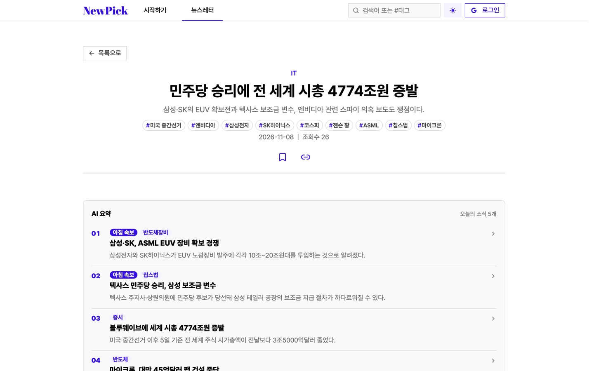
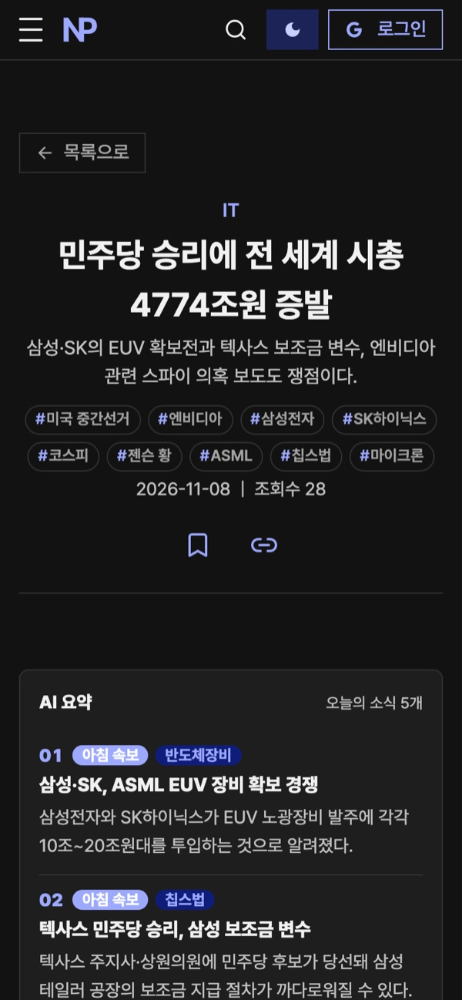
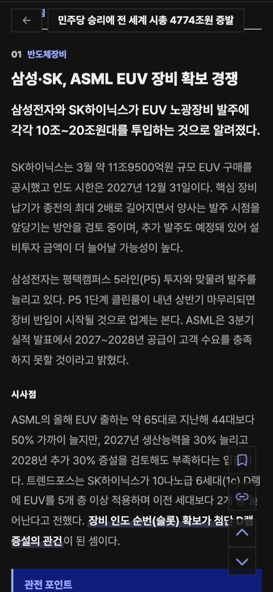
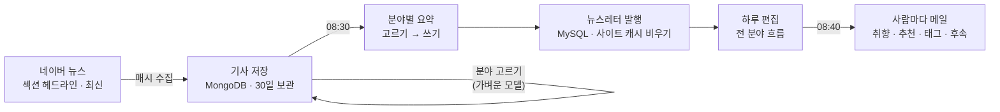
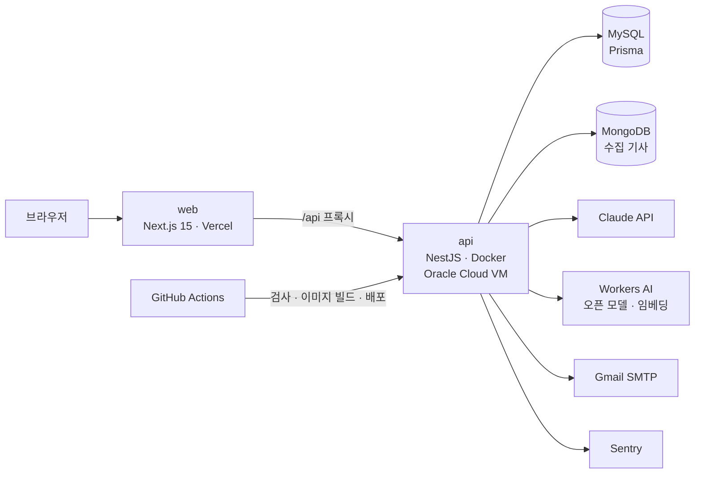

# NewPick

**내 관심사만 골라, 매일 아침 한 통으로.** AI가 그날의 기사를 읽고 분야별로 중요한 소식만 골라 정리한 뉴스레터를 사이트와 메일로 보내는 서비스입니다.

🔗 <https://newpick.hyeoniverse.com>


| | |
| --- | --- |
| **무엇** | 네이버 뉴스를 매시 모아, 매일 아침 분야(IT · 경제 · 정치 · 사회 · 세계 · 생활)마다 AI가 쓴 뉴스레터를 발행하고, 구독자마다 관심사 · 취향에 맞춘 메일 한 통을 보냅니다 |
| **v1** (2024.12 – 2025.02) | 프로그래머스 데브코스 5인 팀 프로젝트 (FE 2 · BE 3). 프론트엔드 · 기획 · 로그인 담당 |
| **v2** (2026.10 – ) | 혼자 이어받아 **풀스택**으로 다시 설계 · 운영. 웹 · api · AI 파이프라인 · 배포 · 리팩토링 |

## 화면

| 뉴스레터 상세 | 휴대폰 · 다크 모드 | 소식 본문 · 형광펜 |
| --- | --- | --- |
|  |  |  |

## 주요 기능

| 기능 | 내용 |
| --- | --- |
| **분야별 AI 뉴스레터** | 매일 08:30, 분야마다 주요 소식 최대 3개 + **오늘 아침 속보**. 소식마다 내용에 맞는 템플릿(지표 카드 · 날짜별 경과 · 문답 · 인용 · 해설 · 단신), 핵심 문장 형광펜, 엇갈린 주장, 관전 포인트 |
| **맞춤 메일** | 구독자마다 한 통: 고른 분야 + 북마크 · 스크랩으로 계산한 **취향 점수**로 소식 순서를 바꾸고, 사람마다 쓴 제목 · 브리핑, 뉴스레터에 안 실린 **추천 기사**, **팔로우한 태그** 소식, **지켜보던 소식의 후속**을 붙임. 원클릭 수신 거부 |
| **읽기 도구** | 문장 형광펜 · 메모 · 폴더(스크랩), 북마크, 소식 **후속 지켜보기**, 태그 · 검색, 받은 메일 다시 보기 |
| **관리자** | 예약 작업 대시보드(수집 · 요약 · 메일 실행 기록, 지금 실행, 시각 바꾸기), AI 기록 · 비용, 구독 · 발송 · 방문 통계, 페이지 히트맵 |

## 동작 흐름



예약 시각은 관리자 화면에서 바꿀 수 있고(순서 검사), 작업마다 실행 기록(성공 · 일부 실패 · 실패와 이유)이 남아 대시보드에서 봅니다.

## AI 설계

| 결정 | 이유 |
| --- | --- |
| **고르기 → 쓰기 2단계** | 모든 기사를 비싼 모델에 넣지 않습니다. 가벼운 모델이 묶음마다 제목 · 첫 부분만 보고 점수(파급 · 새로움 · 관심사 · 후속)를 매기고, 기본 모델은 고른 소식의 대표 기사만 받아 씁니다 |
| **같은 사건 묶기** | 임베딩(bge-m3)으로 같은 사건을 다룬 기사를 한 묶음으로. 다른 언론사 기사를 먼저 보내 엇갈린 주장을 찾게 합니다. 임베딩이 안 되면 제목으로만 묶고 멈추지 않습니다 |
| **JSON 스키마 + 정리 단계** | 응답을 스키마로 받고, 코드가 글자 수 · 형광펜 개수 · 따옴표 · 템플릿 요소를 다시 맞춥니다. 모델 출력이 흔들려도 화면 · 메일 모양이 깨지지 않습니다 |
| **오픈 모델 우선 + 비용 상한** | 맞춤 글 · 후속 판정은 무료 할당의 오픈 모델(Workers AI)로 쓰고, 안 되면 Claude로 넘기되 **하루 비용 상한**을 둡니다. 뉴스레터 본문처럼 품질이 중요한 곳만 Claude |
| **실패해도 나머지는 계속** | 분야 하나가 실패해도 다른 분야는 발행하고, 실패한 분야는 잠시 뒤 다시 시도합니다. 실패해도 그때까지 쓴 토큰 · 비용은 기록합니다 |
| **동작 고정 테스트** | 프롬프트 · 스키마를 고칠 때 가짜 응답으로 바꾸기 전 · 후 출력을 바이트 단위로 비교합니다 (Claude 호출 없이) |

## 아키텍처



## 기술 스택

| 영역 | 기술 |
| --- | --- |
| web | Next.js 15 (App Router · ISR), React 19, TypeScript, Tailwind CSS v4, React Query, zustand |
| api | NestJS 10, Prisma (MySQL), Mongoose (MongoDB), jsdom (수집 · HTML 정리), nodemailer |
| AI | Claude (요약 · 편집), Cloudflare Workers AI (오픈 모델 · 임베딩) |
| 인프라 | Vercel, Oracle Cloud VM + Docker, GitHub Actions (CI · 자동 배포), Sentry |
| 품질 | Vitest · Jest · Playwright, ESLint 9 · Prettier, madge (순환 import), 화면 · 응답 비교 도구 |
| 저장소 | npm workspaces 모노레포 (`apps/web` · `apps/api` · `packages/shared`) |

## v1 → v2: 팀 프로젝트를 운영 서비스로

팀 프로젝트가 끝난 코드를 이어받아, 기능을 더하기 전에 **재고(측정) → 안전망 → 정리** 순으로 두 번 리팩토링했습니다. 모든 단계는 이슈로 계획하고 PR마다 바꾸기 전 · 후를 비교했습니다.

**1차 (#4)**: 기준선 측정 · 보안 · 배포 · 테스트

| | 전 | 후 |
| --- | --- | --- |
| api 의존성 취약점 (critical · high) | 6 · 108 | 0 · 11 |
| 테스트 | 0개 (실패하는 빈 틀) | api · 웹 단위 · E2E, PR마다 CI |
| 렌더링 | 모든 페이지 동적 | 정적 + 10분 재생성 (새 뉴스레터가 나오면 바로 다시 만듦) |
| 배포 | 없음 | Vercel + Oracle 무료 VM, main에 들어가면 자동 배포 |
| 스타일 | styled-components | Tailwind v4 (화면 비교로 모양 그대로 옮김) |

**2차 (#202)**: 구조 · 타입 · 상수 · 도구

| | 전 | 후 |
| --- | --- | --- |
| 공유 타입 | 웹이 api 응답 · 오류 code를 손으로 다시 적음 | 공유 패키지 하나, 어긋나면 타입 오류 |
| 큰 파일 (하는 일 단위로 나눔) | 뉴스레터 쓰기 1047줄 · 예약 작업 916줄 · 마이페이지 503줄 · 날짜 고르기 496줄 | 200 · 180 · 93 · 10줄 (나머지는 하는 일별 파일) |
| 환경 변수 | 40곳에서 직접 읽음, 시작 검사 3개 | 설정 파일 한 곳, 필수 · 형식 · 짝 검사 |
| 모듈 경계 | 서로 import하는 모듈 7쌍, 순환 import 3개 | **0 · 0** (CI가 막음) |
| api 타입 | `strictNullChecks` · `noImplicitAny` 꺼짐 | `strict: true`, `any` 0곳 |
| 도구 | 두 앱의 포맷 · ESLint 판이 다름 | 같은 Prettier · ESLint 9 |
| 테스트 | api 362 · 웹 109 | api **410** · 웹 **176** · E2E 5개 묶음 |

정한 규칙은 lint · 검사 스크립트로 잠가 다시 흐트러지지 않게 했습니다 ([docs/structure.md](docs/structure.md)).

## 운영하며 해결한 문제

| 문제 | 원인 | 해결 |
| --- | --- | --- |
| 이틀 동안 모든 분야 뉴스레터 발행 실패 | 고르기 응답에 제목 칸을 더한 뒤 응답 한도(6000 토큰)에서 잘림 | 실제 최대치를 측정해 한도를 넉넉히 두고, 실패해도 나머지 분야 · 사용량 기록은 남게 |
| 기사 하나의 분야 고르기 실패로 그 시간 수집 전체 실패 | 병렬 처리(`Promise.all`)가 한 건 실패로 통째로 거절 | 실패한 기사만 빼고 저장, 다음 회차에 다시 (#284) |
| 운영 상세 화면만 500 (화면은 정상처럼 보임) | 서버에서 본문을 정리하는 jsdom 30이 ESM 패키지를 `require()` → Vercel 런타임이 막음. 브라우저가 다시 그려 드러나지 않음 | 로컬에서 Node 버전 · 배포 방식별로 재현해 원인 확정, 서버 정리용 jsdom만 CommonJS 판으로 고정 (#293) |
| 리팩토링으로 동작이 바뀌는 위험 | 큰 구조 변경 | 화면 23개 × 라이트 · 다크 · 휴대폰 비교, api 응답 44개 비교, AI 출력 바이트 비교를 PR마다 |

## 개발

| 경로 | 내용 |
| --- | --- |
| [`apps/web`](apps/web) | 프론트엔드 (Next.js) |
| [`apps/api`](apps/api) | 백엔드 (NestJS) |
| [`packages/shared`](packages/shared) | 웹 · api가 함께 쓰는 상수와 타입 (`@newpick/shared`) |

폴더 · 타입 · 상수 · 요청 · 스타일 · 모듈 규칙과 그 규칙을 막는 검사는 [docs/structure.md](docs/structure.md)에 있습니다.

### 설치 · 실행

npm workspaces로 묶여 있어 **저장소 루트에서 한 번** 설치합니다 (잠금 파일은 루트 `package-lock.json` 하나).

```bash
npm ci                 # 두 앱 모두 설치 (한 앱만: npm ci -w apps/web)
npm run dev:web        # 웹 (localhost:3000)
npm run dev:api        # api (localhost:3001, apps/api/README.md의 .env 먼저)
npm test               # 두 앱의 테스트
```

- 패키지 추가 · 삭제도 루트에서 앱을 지정합니다: `npm install dayjs -w apps/web`
- 설치하면 `postinstall`이 `packages/shared`를 빌드합니다 (두 앱은 빌드된 `dist`를 씁니다). 공유 패키지를 고쳤으면 `npm run build -w @newpick/shared`
- api Docker 이미지는 루트를 컨텍스트로 만듭니다: `docker build -f apps/api/Dockerfile .`

### 검사

앱 폴더에서 CI와 같은 순서로 돌립니다 (`.github/workflows/ci.yml`).

```bash
npm run typecheck   # tsc
npm run lint        # ESLint 9
npm run cycles      # 순환 import (+ api: 모듈끼리 서로 import · import 방식)
npm test            # web: vitest (npm run test:cov로 coverage) · api: jest
npm run build
```

### 문서

| 문서 | 내용 |
| --- | --- |
| [docs/structure.md](docs/structure.md) | 구조와 규칙 (어디서 막는지 포함) |
| [docs/deployment.md](docs/deployment.md) | 배포 · 서버 · 환경 변수 |
| [docs/api-errors.md](docs/api-errors.md) | api 오류 응답 모양과 code |
| [docs/visual-diff.md](docs/visual-diff.md) · [docs/api-snapshot.md](docs/api-snapshot.md) | 바꾸기 전 · 후 비교 도구 (화면 · api 응답) |
| [docs/baseline.md](docs/baseline.md) | 측정값 (번들 크기 · 의존성 취약점 · 테스트) |
| [docs/performance.md](docs/performance.md) | 모바일 성능: 측정 방법 · 찾은 원인 · 전 · 후 |
| [docs/v1/](docs/v1) | 팀 프로젝트(v1) 당시 README |

- v1 원본 레포: [Devcourse-NewPick/front](https://github.com/Devcourse-NewPick/front), [Devcourse-NewPick/back](https://github.com/Devcourse-NewPick/back). 이 레포의 `v1-team-final` 태그까지가 팀 작업이며, 커밋 메시지의 PR 번호는 원본 레포의 PR을 가리킵니다.
