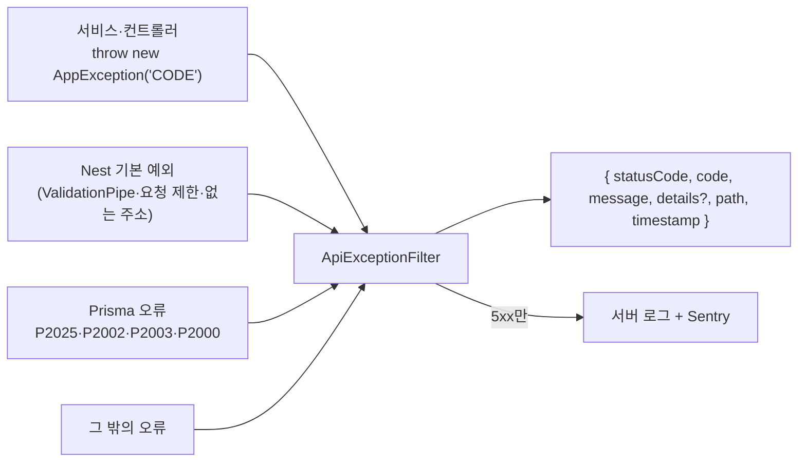

# API 오류 응답 규칙

모든 API 오류는 같은 모양으로 나갑니다. 프론트는 `status`(HTTP 상태)나 `code`로 분기하고, `message`는 사용자에게 그대로 보여 줘도 됩니다.

```json
{
  "statusCode": 404,
  "code": "NEWSLETTER_NOT_FOUND",
  "message": "뉴스레터를 찾을 수 없습니다.",
  "path": "/newsletters/6",
  "timestamp": "2026-10-27T00:00:00.000Z"
}
```

| 필드 | 설명 |
|---|---|
| `statusCode` | HTTP 상태 코드와 같음 |
| `code` | 고정 이름. 메시지는 바뀌어도 code는 바꾸지 않음 |
| `message` | 한국어 문장 |
| `details` | 있을 때만. 입력값 오류 목록(`VALIDATION_FAILED`), 400의 영어 사유, 잘못된 분야 id 등 |
| `path`, `timestamp` | 요청 주소, 시각 |

## 흐름



- 코드: [`apps/api/src/common/errors/`](../apps/api/src/common/errors/)
  - `error-codes.ts`: code · 상태 · 메시지 표 (새 오류는 여기에 먼저 더함)
  - `app.exception.ts`: `new AppException('CODE', 메시지?, details?)`
  - `api-exception.filter.ts`: 모든 오류를 위 모양으로 바꾸는 전역 필터
- 웹: [`apps/web/src/api/client.ts`](../apps/web/src/api/client.ts)의 `ApiError`가 `status` · `code` · `message`를 담음

## 규칙

1. **서비스 오류는 `AppException`으로 던진다.** `NotFoundException('...')`처럼 Nest 예외를 직접 쓰지 않는다.
2. **빈 목록은 오류가 아니다.** 북마크·기간별 뉴스레터가 없으면 `200`과 `[]`(하나를 찾는 API면 `data: null`). `404`는 "그 대상이 없음"에만.
3. **상태 코드는 뜻에 맞게.** 로그인 안 함 `401`, 로그인했지만 권한 없음 `403`, 겹침 `409`, 입력값 오류 `400`.
4. **내부 정보를 응답에 싣지 않는다.** 5xx의 원래 메시지·스택, 빠진 환경 변수 이름, 토큰 검증이 어느 단계에서 실패했는지는 로그에만.
5. **브라우저가 직접 여는 주소는 JSON 대신 사이트로 돌려보낸다.** 구글 로그인 콜백이 실패하면 `/?login=failed`로 리다이렉트.
6. 3xx(301·302·303·307·308)는 오류가 아니라 이동 응답이다. 오류 표에 넣지 않는다.

## code 목록

| code | 상태 | 메시지 |
|---|---|---|
| `BAD_REQUEST` | 400 | 요청이 올바르지 않습니다. |
| `VALIDATION_FAILED` | 400 | 입력값을 확인해 주세요. (`details`에 항목별 사유) |
| `INVALID_INTERESTS` | 400 | 관심 분야를 다시 골라 주세요. |
| `UNAUTHORIZED` | 401 | 로그인이 필요합니다. |
| `SESSION_EXPIRED` | 401 | 로그인이 만료되었습니다. 다시 로그인해 주세요. |
| `FORBIDDEN` | 403 | 권한이 없습니다. |
| `ADMIN_ONLY` | 403 | 관리자만 할 수 있습니다. |
| `NOT_FOUND` | 404 | 요청한 정보를 찾을 수 없습니다. |
| `ROUTE_NOT_FOUND` | 404 | 없는 API 주소입니다. |
| `NEWSLETTER_NOT_FOUND` | 404 | 뉴스레터를 찾을 수 없습니다. |
| `CATEGORY_NOT_FOUND` | 404 | 분야를 찾을 수 없습니다. |
| `EDITION_NOT_FOUND` | 404 | 고른 분야의 발행본이 없습니다. |
| `NEWS_NOT_FOUND` | 404 | 요약할 뉴스를 찾지 못했습니다. |
| `USER_NOT_FOUND` | 404 | 회원 정보를 찾을 수 없습니다. |
| `BOOKMARK_NOT_FOUND` | 404 | 북마크를 찾을 수 없습니다. |
| `SUBSCRIPTION_NOT_FOUND` | 404 | 구독 정보가 없습니다. |
| `METHOD_NOT_ALLOWED` | 405 | 지원하지 않는 요청 방식입니다. |
| `CONFLICT` | 409 | 이미 처리된 요청입니다. |
| `CATEGORY_ALREADY_EXISTS` | 409 | 이미 있는 분야입니다. |
| `BOOKMARK_ALREADY_EXISTS` | 409 | 이미 북마크한 뉴스레터입니다. |
| `ALREADY_SUBSCRIBED` | 409 | 이미 구독 중입니다. |
| `PAYLOAD_TOO_LARGE` | 413 | 보낸 내용이 너무 큽니다. |
| `UNPROCESSABLE` | 422 | 처리할 수 없는 값이 있습니다. |
| `TOO_MANY_REQUESTS` | 429 | 요청이 너무 많습니다. 잠시 뒤 다시 시도해 주세요. |
| `INTERNAL_ERROR` | 500 | 서버에 일시적인 문제가 생겼습니다. 잠시 뒤 다시 시도해 주세요. |
| `BAD_GATEWAY` | 502 | 외부 서비스와 연결하지 못했습니다. 잠시 뒤 다시 시도해 주세요. |
| `SERVICE_UNAVAILABLE` | 503 | 지금은 이용할 수 없습니다. 잠시 뒤 다시 시도해 주세요. |
| `GOOGLE_LOGIN_UNAVAILABLE` | 503 | 지금은 구글 로그인을 쓸 수 없습니다. |
| `SITE_CACHE_UNAVAILABLE` | 503 | 사이트 캐시 비우기가 설정되지 않았습니다. |
| `SITE_CACHE_FAILED` | 502 | 사이트 캐시를 비우지 못했습니다. 잠시 뒤 다시 시도해 주세요. |
| `GATEWAY_TIMEOUT` | 504 | 외부 서비스 응답이 늦습니다. 잠시 뒤 다시 시도해 주세요. |

code가 없는 Nest 기본 예외는 상태 코드로 대표 code를 정합니다 (400 → `BAD_REQUEST`, 404 → `NOT_FOUND`, 429 → `TOO_MANY_REQUESTS` …). Prisma 오류는 `P2025` → `NOT_FOUND`, `P2002`·`P2003` → `CONFLICT`, `P2000` → `VALIDATION_FAILED`.
