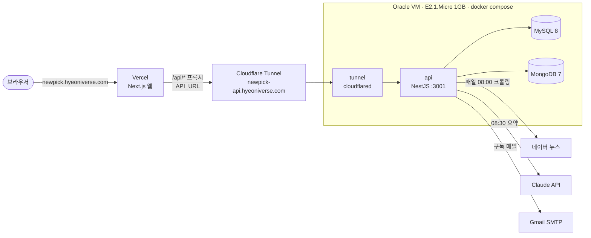
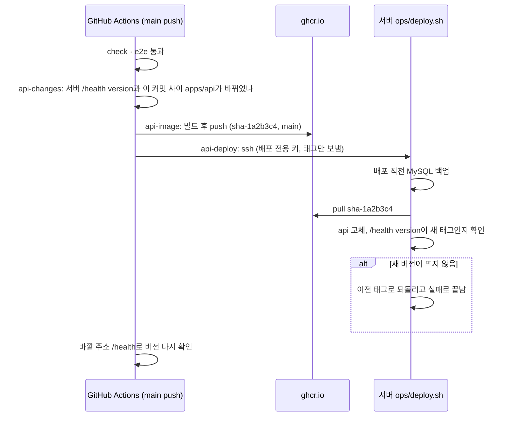

# 배포

웹은 Vercel에, api와 DB는 Oracle Cloud Always Free VM 한 대에 둡니다. 서버는 인바운드 포트를 열지 않고 Cloudflare Tunnel로만 외부와 연결합니다. AI 요약(Claude API) 사용량 말고는 비용이 들지 않습니다 ([#39](https://github.com/hyeoniverse/newpick/issues/39)).



| 무엇 | 주소 | 어디에 | 배포 |
|---|---|---|---|
| 웹 | `https://newpick.hyeoniverse.com` | Vercel Hobby | main에 머지하면 Vercel이 |
| api | `https://newpick-api.hyeoniverse.com` | Oracle VM, docker compose | main에 머지하면 GitHub Actions가 이미지를 만들어 서버에 |
| 헬스 체크 | `https://newpick-api.hyeoniverse.com/health` | | `{"status":"ok","version":"sha-…"}` |

브라우저는 웹의 `/api` 프록시(`apps/web/next.config.ts`의 rewrites)로만 api를 부릅니다. 그래서 로그인 쿠키는 웹 도메인에 저장되고 `COOKIE_DOMAIN`은 비워 둡니다.

- [왜 이렇게 했나](#왜-이렇게-했나)
- [1. 웹 (Vercel)](#1-웹-vercel)
- [2. Google OAuth 클라이언트](#2-google-oauth-클라이언트)
- [3. Oracle VM 만들기](#3-oracle-vm-만들기)
- [4. 서버 준비](#4-서버-준비)
- [5. Cloudflare Tunnel](#5-cloudflare-tunnel)
- [6. 설정 파일](#6-설정-파일)
- [7. 첫 실행](#7-첫-실행)
- [자동 배포](#자동-배포)
- [운영](#운영)
- [문제 해결](#문제-해결)

## 왜 이렇게 했나

- api에 **매일 08:00 크롤링, 08:30 Claude 요약** cron이 있습니다(`apps/api/src/scheduler`). 요청이 없으면 잠드는 무료 PaaS에서는 이 작업이 돌지 않습니다.
- 데이터가 작습니다. 크롤링 원문(Mongo `CrawledNews`)은 TTL 30일로 지워지고, 뉴스레터는 카테고리마다 하루 1건이라 **1년에 200MB 안팎**입니다. 무료 VM 디스크(45GB)로 충분합니다.
- api + MySQL + Mongo가 약 600MB를 씁니다. 1GB VM에 맞추려고 MySQL과 Mongo의 캐시를 줄이고 swap 4GB를 둡니다.
- DB를 api와 같은 VM에 두면 무료 DB 서비스의 용량 제한·휴면·해외 리전 지연이 없습니다. 대신 [백업](#백업)을 직접 합니다.

## 1. 웹 (Vercel)

1. Vercel에서 `hyeoniverse/newpick` 저장소로 프로젝트를 만듭니다. 이미 만든 프로젝트면 **Settings → Git → Connect Git Repository**로 연결합니다. 연결하지 않으면 배포 목록에 "No Deployment"만 보입니다.
2. **Settings → Build and Deployment → Root Directory**: `apps/web`
3. **Settings → Environment Variables**

   | 키 | 값 | 환경 |
   |---|---|---|
   | `API_URL` | `https://newpick-api.hyeoniverse.com` (끝에 `/` 없이) | Production, Preview |

   `API_URL`은 빌드할 때 프록시 주소로 들어갑니다. 바꾼 뒤에는 **Redeploy**해야 반영됩니다. 없으면 `http://localhost:3001`로 프록시해서 `/api/*`가 `404 DNS_HOSTNAME_RESOLVED_PRIVATE`가 됩니다.
4. **Settings → Domains**에 `newpick.hyeoniverse.com`을 추가하고, Vercel이 알려 주는 CNAME 값을 Cloudflare DNS에 **DNS only(회색 구름)**로 넣습니다. 값은 프로젝트마다 다릅니다(`….vercel-dns-0xx.com`).

홈은 빌드할 때 api에서 데이터를 읽어 정적으로 만들고, 10분마다 다시 만듭니다(`revalidate = 600`). api가 떠 있어야 빌드할 때 데이터가 들어갑니다. DB가 비어 있으면 빌드 로그에 `ApiError: Not Found`(404)가 찍히지만 빌드는 성공합니다.

## 2. Google OAuth 클라이언트

Google Cloud Console → **Google 인증 플랫폼 → 클라이언트**(또는 API 및 서비스 → 사용자 인증 정보) → OAuth 클라이언트 ID 만들기

- 애플리케이션 유형은 **웹 애플리케이션**입니다. 데스크톱 앱 유형에는 "승인된 리디렉션 URI" 칸이 없어 실제 도메인을 넣을 수 없습니다(localhost만 됨).
- 승인된 리디렉션 URI
  - `https://newpick.hyeoniverse.com/api/auth/google/callback`
  - `http://localhost:3000/api/auth/google/callback` (로컬 개발)
- **대상(Audience)**이 "테스트"면 테스트 사용자만 로그인할 수 있습니다. 공개하려면 앱을 게시합니다.

키가 없어도 api는 뜨고, `/auth/google`만 503으로 무엇이 빠졌는지 알려 줍니다([#37](https://github.com/hyeoniverse/newpick/pull/37)).

## 3. Oracle VM 만들기

[Always Free](https://www.oracle.com/cloud/free/) 한도 안에서는 기간 제한 없이 무료입니다. Compute → Instances → **Create instance**

| 항목 | 고를 것 |
|---|---|
| Image | **Canonical Ubuntu 24.04**. 기본값이 20.04(지원 종료, Docker 미지원)일 수 있으니 **Change image**로 바꿉니다 |
| Shape | `VM.Standard.E2.1.Micro`(AMD, 1GB, 2대까지 무료) 또는 `VM.Standard.A1.Flex`(ARM). "Always Free Eligible" 표시를 확인합니다 |
| Networking | public subnet, **Automatically assign public IPv4 address** |
| SSH keys | Generate a key pair → **Download private key** (다시 받을 수 없음) |

만든 직후 1~2분은 SSH가 `Connection refused`입니다(부팅 중). 막힌 것이 아닙니다.

```bash
mv ~/Downloads/ssh-key-*.key ~/.ssh/oracle-newpick.key && chmod 600 ~/.ssh/oracle-newpick.key
cat >> ~/.ssh/config <<'EOF'

Host newpick
  HostName <공인 IP>
  User ubuntu
  IdentityFile ~/.ssh/oracle-newpick.key
  IdentitiesOnly yes
EOF
ssh newpick
```

VM을 다시 만들어 IP가 바뀌면 `~/.ssh/config`의 `HostName`을 고치고 `ssh-keygen -R <예전 IP>`로 예전 호스트 키를 지웁니다. 같은 `Host` 항목이 두 개면 위의 것이 쓰입니다.

## 4. 서버 준비

아래는 모두 서버(`ssh newpick`)에서 실행합니다.

```bash
# swap 4GB: 메모리 1GB라 급할 때 서버에서 빌드하면 OOM이 난다
sudo fallocate -l 4G /swapfile && sudo chmod 600 /swapfile
sudo mkswap /swapfile && sudo swapon /swapfile
echo '/swapfile none swap sw 0 0' | sudo tee -a /etc/fstab

# Docker
sudo apt update && sudo apt upgrade -y
curl -fsSL https://get.docker.com | sudo sh
sudo usermod -aG docker ubuntu
exit   # 다시 접속해야 docker 그룹이 적용된다
```

### 코드 (비공개 저장소)

저장소가 비공개라 서버 전용 **읽기 전용 deploy key**로 받습니다. 코드는 `ops/deploy.sh`·`ops/backup.sh`를 쓰려고 받습니다(api는 이미지로 돌아갑니다).

```bash
ssh-keygen -t ed25519 -f ~/.ssh/newpick_deploy -N '' -C newpick-server
cat ~/.ssh/newpick_deploy.pub
```

GitHub 저장소 → **Settings → Deploy keys → Add deploy key**(https://github.com/hyeoniverse/newpick/settings/keys)에 붙여 넣습니다. **Allow write access는 체크하지 않습니다.** 계정의 "SSH and GPG keys"에 넣으면 모든 저장소에 접근할 수 있게 되니 주의합니다.

```bash
printf 'Host github.com\n  IdentityFile ~/.ssh/newpick_deploy\n  IdentitiesOnly yes\n' >> ~/.ssh/config
git clone git@github.com:hyeoniverse/newpick.git ~/newpick
mkdir -p ~/deploy ~/backups
```

### GHCR 로그인

api 이미지(`ghcr.io/hyeoniverse/newpick-api`)는 비공개 패키지라 서버가 로그인해야 받을 수 있습니다. GitHub → Settings → Developer settings → **Personal access tokens (classic)** → Generate new token에서 **`read:packages`만** 체크해 만들고, 서버에서 한 번 로그인합니다.

```bash
docker login ghcr.io -u hyeoniverse   # Password에 토큰
```

로그인 정보는 `~/.docker/config.json`에 남습니다. 토큰에 만료일을 두었다면 만료 전에 다시 로그인합니다(만료되면 배포가 "이미지를 받지 못해 아무것도 바꾸지 않았다"로 멈춥니다).

## 5. Cloudflare Tunnel

Cloudflare 대시보드(계정 첫 화면) → **Networking → Tunnels → Create a tunnel** → Cloudflared → 이름 `newpick-api`

1. 운영체제는 **Docker**를 고릅니다. 나오는 `docker run … --token eyJ…` 명령은 **실행하지 않고** `--token` 뒤의 값만 복사합니다. 이 화면의 "아직 연결이 감지되지 않음"은 서버에서 tunnel 컨테이너를 띄우면 사라집니다.
2. **Routes → Add route → Published application**

   | 칸 | 값 |
   |---|---|
   | 서브도메인 | `newpick-api` |
   | 도메인 | `hyeoniverse.com` |
   | 서비스 URL | `http://api:3001` |

   - `https://`가 아니라 `http://`입니다. 바깥 https는 Cloudflare가 처리합니다.
   - `api`는 compose 서비스 이름입니다. `localhost`로 쓰면 tunnel 컨테이너 자신을 가리킵니다.
   - `api.newpick.hyeoniverse.com`처럼 두 단계 서브도메인은 무료 인증서가 적용되지 않습니다.

## 6. 설정 파일

모두 서버의 `~/deploy`에 둡니다. 저장소 밖이라 커밋되지 않고 `git pull`해도 남습니다.

```
/home/ubuntu/
├── newpick/      코드 (git clone). ops/deploy.sh, ops/backup.sh
├── deploy/
│   ├── .env          compose 변수: MYSQL_ROOT_PASSWORD, TUNNEL_TOKEN, API_TAG
│   ├── api.env       api 환경 변수
│   ├── compose.yml   ops/compose.yml을 복사
│   └── deploy.log    배포 기록
└── backups/      MySQL 덤프 (7일 보관)
```

**`.env`와 `api.env`는 다른 파일입니다.** `.env`는 compose가 `${…}`를 채울 때 읽고, `api.env`는 api 컨테이너의 환경 변수입니다. `.env`에 로컬 `apps/api/.env`를 붙여 넣으면 `MYSQL_ROOT_PASSWORD`가 비어 api가 `P1000 Authentication failed`로 뜨지 않습니다([문제 해결](#문제-해결)).

YAML이나 여러 줄을 터미널에 그대로 붙여 넣지 말고 `cat > 파일 <<'EOF' … EOF`로 감싸서 붙여 넣습니다.

### `.env`

```bash
cd ~/deploy
cat > .env <<EOF
MYSQL_ROOT_PASSWORD=$(openssl rand -hex 24)
TUNNEL_TOKEN=<5단계에서 복사한 토큰>
EOF
chmod 600 .env
```

`API_TAG`는 `ops/deploy.sh`가 씁니다. 손으로 넣지 않습니다.

### `api.env`

```bash
cat > api.env <<EOF
JWT_SECRET=$(openssl rand -hex 32)
JWT_REFRESH_SECRET=$(openssl rand -hex 32)
FRONTEND_URL=https://newpick.hyeoniverse.com
GOOGLE_CLIENT_ID=
GOOGLE_CLIENT_SECRET=
GOOGLE_REDIRECT_URI=https://newpick.hyeoniverse.com/api/auth/google/callback
ANTHROPIC_API_KEY=
MAIL_USER=
MAIL_PASSWORD=
ADMIN_NOTIFY_EMAIL=
EOF
chmod 600 api.env
nano api.env   # 빈 값을 채운다
```

| 변수 | 필수 | 설명 |
|---|---|---|
| `JWT_SECRET`, `JWT_REFRESH_SECRET` | ✓ | 로컬 값을 재사용하지 않고 새로 만든다 |
| `FRONTEND_URL` | ✓ | CORS 허용 주소, 로그인 후 돌아갈 주소, 메일 속 링크 |
| `GOOGLE_CLIENT_ID`, `GOOGLE_CLIENT_SECRET`, `GOOGLE_REDIRECT_URI` | 로그인 | 비우면 로그인만 503 |
| `ANTHROPIC_API_KEY` | 요약 | 매일 요약과 무료 체험. `CLAUDE_MODEL`로 모델을 바꿀 수 있다 |
| `PEXELS_API_KEY`, `UNSPLASH_ACCESS_KEY` | | 원출처 사진이 없는 소식에 넣을 사진 검색 (Pexels 먼저). 없으면 원출처 사진만 쓴다 |
| `CLAUDE_MODEL`, `CLAUDE_FAST_MODEL` | | 뉴스레터 쓰기 모델(기본 `claude-sonnet-5-5`)과 기사 고르기·분류 모델(기본 `claude-haiku-5-5`). 비워 두면 기본값 |
| `MAIL_USER`, `MAIL_PASSWORD` | 메일 | Gmail 주소와 **앱 비밀번호**(16자리). 실제 비밀번호는 SMTP 로그인이 거절된다. 2단계 인증을 켜고 https://myaccount.google.com/apppasswords 에서 만든다 |
| `ADMIN_NOTIFY_EMAIL` | | 요약이 끝나면 결과를 받을 주소 |
| `SENTRY_DSN` | | 오류 기록·성능 측정(Sentry). **필수 아님**: 비우면 "SENTRY_DSN이 없어 Sentry 없이 실행합니다"를 남기고 그대로 실행. 켜는 방법과 개인정보 처리방침에 미치는 영향은 #67 |

전체 목록은 `apps/api/.env.example`에 있습니다. `NODE_ENV=production`, `TZ=Asia/Seoul`은 Dockerfile에 들어 있습니다.

### `compose.yml`

```bash
cp ~/newpick/ops/compose.yml ~/deploy/compose.yml
```

[`ops/compose.yml`](../ops/compose.yml)에는 `ports`가 없습니다. 바깥 요청은 tunnel로만 api에 닿고, DB는 compose 네트워크 밖에서 접근할 수 없습니다. 1GB 서버에 맞춰 MySQL `innodb-buffer-pool-size=64M`·`performance-schema=OFF`, Mongo `wiredTigerCacheSizeGB=0.25`로 줄였습니다.

## 7. 첫 실행

GHCR에 이미지가 있어야 합니다. main에 api 변경이 머지되면 Actions의 `api-image`가 만들고, 저장소 오른쪽 **Packages → newpick-api**에서 태그(`sha-` + 커밋 7자리)를 볼 수 있습니다.

```bash
~/newpick/ops/deploy.sh sha-1a2b3c4   # 예시 태그. .env에 API_TAG를 쓰고 api(+DB)를 띄워 version까지 확인
cd ~/deploy && docker compose up -d   # tunnel까지
docker compose logs -f api            # migration 후 "Nest application successfully started"
```

시작할 때 `prisma migrate deploy`가 먼저 돕니다. 카테고리 6개도 migration(`20261019000001_seed_categories`)에 들어 있어 따로 넣지 않습니다. Cloudflare Tunnels 화면에서 상태가 **HEALTHY**면 연결된 것입니다.

확인 (내 컴퓨터에서)

```bash
curl https://newpick-api.hyeoniverse.com/health        # {"status":"ok","version":"sha-…"}
curl https://newpick.hyeoniverse.com/api/category      # 카테고리 6개 (Vercel → Tunnel → api)
curl -I https://newpick.hyeoniverse.com/api/auth/google  # 302 → accounts.google.com
```

### 처음 데이터 채우기

DB가 비어 있으면 홈·목록이 비고 트렌드 API가 404입니다. 다음 날 08:00 cron을 기다리지 않으려면 api 컨테이너 안에서 크롤링과 요약을 한 번 돌립니다(Claude API 비용이 조금 듭니다. 2026-10-26 기준 기사 51건 크롤링 약 4분, 6개 카테고리 요약 약 10분).

```bash
cd ~/deploy && docker compose exec -T api node -e '
const { NestFactory } = require("@nestjs/core");
const { AppModule } = require("./dist/src/app.module");
const { SchedulerService } = require("./dist/src/scheduler/scheduler.service");
(async () => {
  const app = await NestFactory.createApplicationContext(AppModule, { logger: ["log", "warn", "error"] });
  const s = app.get(SchedulerService);
  await s.startCrawling();
  await s.makeAiSummary();
  await app.close();
  process.exit(0);
})();'
```

요약은 카테고리 순서대로 만들어집니다. 도중에 홈이 다시 만들어지면 일부 카테고리만 10분 동안 보일 수 있습니다(다음 재생성에서 채워짐).

## 자동 배포



- apps/api가 바뀌지 않은 머지(웹만 바꾼 PR 등)는 api를 다시 띄우지 않습니다. 비교 대상은 직전 push가 아니라 **서버에 떠 있는 버전**이라, 실패한 배포가 다음 push에서 빠지지 않습니다.
- PR에서는 이미지가 빌드되는지만 봅니다(`api-docker`). 올리거나 배포하지 않습니다.
- 손으로 배포·되돌리기: Actions → **api 배포** → Run workflow → 태그 입력. 예전 태그를 넣으면 되돌리기입니다. 이 워크플로는 GHCR에 이미 있는 태그만 배포합니다.
- api 변경 없이 지금 main을 새로 빌드해 배포하려면: Actions → **CI** → Run workflow (branch `main`). 시험·e2e를 거친 뒤 이미지를 만들어 배포합니다. 서버에서 직접 빌드한 이미지가 떠 있어 GHCR에 그 태그가 없을 때도 이렇게 바꿉니다.

### 자동 배포 설정 (한 번)

1. **배포 전용 키**를 내 컴퓨터에서 만듭니다.

   ```bash
   ssh-keygen -t ed25519 -f ~/.ssh/newpick-actions -N '' -C newpick-actions
   ```

2. 서버의 `~/.ssh/authorized_keys`에 공개키를 **이 스크립트만 돌릴 수 있게** 묶어 추가합니다. 이 키로는 셸도, 포트 포워딩도 안 되고, 보낸 명령은 태그로만 쓰입니다.

   ```bash
   echo "command=\"/home/ubuntu/newpick/ops/deploy.sh\",no-port-forwarding,no-agent-forwarding,no-X11-forwarding,no-pty $(cat ~/.ssh/newpick-actions.pub)" \
     | ssh newpick 'cat >> ~/.ssh/authorized_keys'
   ```

3. GitHub 저장소 → Settings → **Secrets and variables → Actions → New repository secret**

   | 이름 | 값 |
   |---|---|
   | `DEPLOY_HOST` | 서버 공인 IP |
   | `DEPLOY_SSH_KEY` | `cat ~/.ssh/newpick-actions` (개인 키 전체) |
   | `DEPLOY_KNOWN_HOSTS` | `ssh-keyscan -t ed25519 <공인 IP>` 결과 |

   `DEPLOY_HOST`가 없으면 배포만 건너뛰고 CI는 통과합니다.

4. 키가 묶였는지 확인: `ssh -i ~/.ssh/newpick-actions ubuntu@<IP> nope` → "태그 모양이 아니다"로 끝나면 됩니다.

`ops/deploy.sh`·`ops/backup.sh`를 바꾼 PR을 머지했다면 서버에서 `cd ~/newpick && git pull`로 받습니다(스크립트는 이미지가 아니라 서버의 저장소에서 돕니다).

## 운영

### 백업

```bash
( crontab -l 2>/dev/null | grep -v newpick; \
  echo '# 매일 04:00 KST (서버 시간은 UTC)'; \
  echo '0 19 * * * $HOME/newpick/ops/backup.sh >> $HOME/backups/backup.log 2>&1' ) | crontab -
```

- `~/backups/newpick-<UTC 시각>-daily.sql.gz`, 배포 직전에는 `-predeploy-<태그>`로 남고 7일 뒤 지워집니다.
- 덤프 마지막 줄(`-- Dump completed`)이 없으면 실패로 처리합니다.
- MongoDB는 30일이면 지워지는 크롤링 원문이라 백업하지 않습니다.
- VM 디스크가 망가지면 백업도 사라집니다. 가끔 내 컴퓨터로 받아 둡니다: `scp 'newpick:backups/*.gz' ~/newpick-backups/`

복원

```bash
cd ~/deploy
gunzip -c ~/backups/newpick-…-daily.sql.gz \
  | docker compose exec -T mysql sh -c 'exec mysql -uroot -p"$MYSQL_ROOT_PASSWORD" newpick'
```

### 확인할 것

| 무엇 | 명령 |
|---|---|
| 컨테이너 | `cd ~/deploy && docker compose ps` |
| api 로그 | `docker compose logs -f --tail 100 api` |
| 메모리 | `free -h`, `docker stats --no-stream` |
| 배포 기록 | `tail -50 ~/deploy/deploy.log` |
| 백업 | `ls -lh ~/backups`, `tail ~/backups/backup.log` |
| cron 결과 | 매일 08:00·08:30 KST 로그의 `Successfully created N items`, `카테고리 … 요약` |

2026-10-26 측정: 크롤링·요약 중에도 사용 가능 메모리 약 380MB, swap 약 470MB 사용. swap 사용이 계속 크게 늘면 Mongo를 MongoDB Atlas 무료(M0, 512MB)로 옮기는 것을 검토합니다.

## 문제 해결

| 증상 | 원인 | 해결 |
|---|---|---|
| Vercel에 "No Deployment" | 프로젝트가 GitHub 저장소에 연결되지 않음 | [1. 웹](#1-웹-vercel)의 Git 연결 |
| 웹의 `/api/*`가 `404 DNS_HOSTNAME_RESOLVED_PRIVATE` | Vercel에 `API_URL`이 없어 localhost로 프록시 | `API_URL`을 넣고 Redeploy |
| `ssh: … Connection refused` | VM 부팅 중 | 1~2분 뒤 다시 |
| `docker compose`가 `no configuration file provided` | compose.yml이 없는 폴더에서 실행 | `cd ~/deploy` (로컬은 `apps/api`) |
| `The "MYSQL_ROOT_PASSWORD" variable is not set` 경고, api 로그 `P1000 Authentication failed` | `.env`를 다른 내용으로 덮어씀 | `.env`에 `MYSQL_ROOT_PASSWORD`(DB를 처음 만들 때 값)와 `TUNNEL_TOKEN`을 되돌리고 `docker compose up -d`. DB 비밀번호는 볼륨에 남아 있어 `.env` 값만 바꿔서는 바뀌지 않는다 |
| 바깥에서 502 | api가 떠 있지 않음 | `docker compose logs api` |
| `/auth/google`이 503 | `api.env`에 Google 키가 없음 | 키를 넣고 `docker compose up -d api` |
| Google 콘솔에 "승인된 리디렉션 URI" 칸이 없음 | 클라이언트가 데스크톱 유형 | 웹 애플리케이션 유형으로 새로 만든다 |
| Google 로그인 후 Internal Server Error | 로그인 도중 api가 재시작됨(인가 코드는 한 번만 쓸 수 있음) | 처음부터 다시 로그인 |
| 메일 발송 `535`/`Invalid login` | `MAIL_PASSWORD`가 실제 비밀번호 | 앱 비밀번호로 바꾼다 |
| 배포가 "이미지를 받지 못해 아무것도 바꾸지 않았다" | 서버의 GHCR 로그인 만료, 또는 태그 없음 | `docker login ghcr.io`, Packages에서 태그 확인 |
| 홈에 일부 카테고리만 보임 | 요약 도중 ISR 재생성 | 10분 뒤 다시 만들어짐 |
