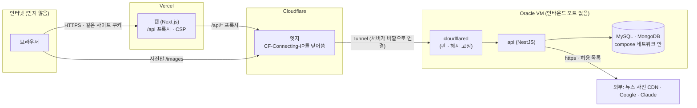

# 보안 설계

뉴픽은 혼자 만들고 운영하는 서비스라 **사고가 나면 막아 줄 사람이 없다**는 전제로 설계했습니다. 기본값을 안전한 쪽에 두고, 그 규칙을 사람이 아니라 테스트 · 검사가 지키게 합니다. 이 문서의 내용은 모두 **지금 코드와 운영 설정에 있는 것**이고, 항목마다 근거(파일 · 테스트)를 붙였습니다.

- 요약은 [README의 보안](../README.md#보안), 이용자에게 보이는 설명은 시작하기(`/about`)의 "내 정보, 이렇게 지킵니다"
- 배포 · 서버 설정은 [deployment.md](deployment.md), 오류 응답 규칙은 [api-errors.md](api-errors.md)

## 목차

1. [구조와 신뢰 경계](#1-구조와-신뢰-경계)
2. [지키는 것과 위협](#2-지키는-것과-위협)
3. [인증 · 세션](#3-인증--세션)
4. [권한](#4-권한)
5. [요청 횟수 제한](#5-요청-횟수-제한)
6. [입력 · 출력](#6-입력--출력)
7. [SSRF: 사진 줄이기 서버](#7-ssrf-사진-줄이기-서버)
8. [브라우저 보호](#8-브라우저-보호)
9. [메일](#9-메일)
10. [비밀값 · 설정](#10-비밀값--설정)
11. [인프라 · 배포](#11-인프라--배포)
12. [공급망 · 의존성](#12-공급망--의존성)
13. [개인정보](#13-개인정보)
14. [점검 기록](#14-점검-기록)
15. [확인 방법](#15-확인-방법)
16. [알려진 한계와 다음 과제](#16-알려진-한계와-다음-과제)

## 1. 구조와 신뢰 경계



| 경계 | 무엇을 믿고, 무엇을 믿지 않나 |
| --- | --- |
| 브라우저 → 웹 | 아무것도 믿지 않습니다. 쿠키는 httpOnly라 스크립트가 읽지 못하고, 브라우저는 같은 사이트의 `/api` 프록시로만 api를 부릅니다 |
| Cloudflare → api | 서버에 인바운드 포트가 없어 **모든 요청이 Cloudflare를 거칩니다**. 그래서 Cloudflare가 넣는 `CF-Connecting-IP`는 믿고, 접속자가 넣을 수 있는 `X-Forwarded-For`는 믿지 않습니다 |
| api → DB | DB 포트는 밖으로 열지 않고(`ops/compose.yml`에 `ports` 없음) compose 네트워크 안에서만 닿습니다 |
| api → 외부 | 사진은 허용한 출처 · https만, 리디렉션도 다음 주소를 요청하기 전에 검사합니다 ([7](#7-ssrf-사진-줄이기-서버)) |

## 2. 지키는 것과 위협

| 지키는 것 | 위협 | 대응 (절) |
| --- | --- | --- |
| 계정 · 세션 | 토큰 탈취(XSS), 토큰 유출, 로그인 CSRF, 세션 고정 | httpOnly 쿠키 · 해시 저장 · rotation · OAuth state ([3](#3-인증--세션)) |
| 다른 사람의 데이터 | 권한 없는 API 호출, 관리자 권한 상승 | 기본 거부 · 관리자는 매 요청 DB 확인 · 정책 테스트 ([4](#4-권한)) |
| 서비스 가용성 | 요청 폭주, 인증 코드 무차별 대입 | 사람별 요청 제한 · 코드 시도 횟수 ([5](#5-요청-횟수-제한), [9](#9-메일)) |
| 서버 · 내부망 | SSRF, 입력 조작, 내부 정보 노출 | 허용 목록 · 단계별 리디렉션 검사 · 입력 검증 · 오류 숨김 ([6](#6-입력--출력), [7](#7-ssrf-사진-줄이기-서버)) |
| 이용자 화면 | 저장형 XSS(AI가 쓴 본문), 클릭재킹 | DOMPurify · `frame-ancestors` ([6](#6-입력--출력), [8](#8-브라우저-보호)) |
| 운영 서버 · 배포 | 노출된 포트, 배포 키 남용, 비밀값 유출 | Tunnel · `command=` 묶은 키 · 환경 변수 검사 ([10](#10-비밀값--설정), [11](#11-인프라--배포)) |
| 빌드 · 의존성 | 알려진 취약점, 설치 스크립트, 바뀌는 이미지 | `npm audit` 0 · `allowScripts` · 이미지 해시 고정 ([12](#12-공급망--의존성)) |
| 개인정보 | 과다 수집, 탈퇴 뒤 잔존 | 최소 수집 · 처리방침 공개 · 한 번에 파기 ([13](#13-개인정보)) |

## 3. 인증 · 세션

| 항목 | 설계 | 근거 |
| --- | --- | --- |
| 로그인 | Google OAuth만. **비밀번호를 받거나 저장하지 않습니다** | `auth/google.strategy.ts` |
| 로그인 CSRF | OAuth `state`: `randomBytes(32)`를 `oauth_state` 쿠키(httpOnly · Secure · SameSite=Lax · 10분)에 두고 구글로 보내는 주소에 같은 값을 실음. 돌아오면 `timingSafeEqual`로 비교, 맞든 틀리든 쿠키는 지움. 세션 저장소가 없어 passport-oauth2의 `store` 자리에 쿠키 저장소를 둠 | `auth/oauth-state.ts` · `__tests__/oauth-state.spec.ts` |
| 토큰 보관 | access(30분) · refresh(30일)는 `httpOnly` · `Secure` · `SameSite=Lax` 쿠키. 스크립트가 읽을 수 있는 `logged_in` 쿠키는 로그인 여부 표시일 뿐 토큰이 아님 | `auth/cookie-options.ts` |
| 토큰 저장 | DB에는 refresh token **원문 대신 SHA-256 해시**만. DB가 새도 토큰을 되살릴 수 없음 | `auth/auth.service.ts` `hashToken` |
| 갱신 | 갱신할 때마다 새 refresh token으로 교체(rotation)하고 만료를 30일로 다시. 동시에 온 요청을 위해 바로 전 토큰은 60초만 같은 세션으로 인정 | `rotateSession` · `ROTATION_GRACE_MS` |
| 기기 관리 | 로그인한 기기 목록, 기기별 로그아웃, 다른 기기 모두 로그아웃. 로그아웃은 이 기기의 세션만 지움 | `auth.controller.ts` `sessions` |
| 계정 바꾸기 | '다른 Google 계정으로 바꾸기'는 누가 바꾸는지 서명한 10분짜리 쿠키(`purpose: 'google-link'`)로 확인. 그 Google 계정 · 이메일을 다른 뉴픽 계정이 쓰면 합치지 않고 거절 | `google-oauth.guard.ts` · `linkGoogleAccount` |
| 로그인 갱신 위치 | 브라우저: api 클라이언트가 401이면 한 번만 갱신(동시 요청은 하나로 묶음). 서버 렌더링: Next middleware가 페이지보다 먼저 갱신해 새 토큰을 요청 쿠키에 넣음 | `apps/web/src/api/client.ts` · `middleware.ts` |

## 4. 권한

- **기본 거부**: 전역 `JwtAuthGuard`가 모든 라우트에 로그인을 요구합니다. 공개 라우트는 `@Public()`, 관리자 라우트는 `@AdminOnly()`로 **하나씩 열어 줍니다**. 새 라우트를 만들고 잊어버리면 공개가 아니라 막힌 쪽이 됩니다
- **관리자 확인은 매 요청 DB에서**: JWT에는 role을 넣지 않습니다. 넣으면 권한을 회수해도 토큰이 끝날 때까지 남기 때문입니다 (`guards/admin.guard.ts`)
- **정책을 테스트로 고정**: `auth/__tests__/route-policy.spec.ts`가 라우트 **120개**의 정책(공개 25 · 로그인 49 · 관리자 46)을 표로 갖고 있습니다. 라우트를 추가 · 삭제하거나 정책이 바뀌면 이 표도 바꿔야 테스트가 통과합니다
- **v1에서 고친 것**: 인증 없이 데이터를 바꾸던 위험한 API를 지우고, 사용자가 스스로 관리자 권한을 얻던 경로를 막았습니다

## 5. 요청 횟수 제한

| 항목 | 설계 | 근거 |
| --- | --- | --- |
| 누구로 세나 | 로그인한 요청은 `user:<id>`, 그 밖은 `ip:<CF-Connecting-IP>`(없으면 `req.ip`, 로컬). `X-Forwarded-For`는 꾸밀 수 있어 쓰지 않음 | `common/client-throttler.guard.ts` · 테스트 |
| 가드 순서 | 로그인 확인 → 요청 제한. 사용자 id로 세려면 `req.user`가 먼저 있어야 함 | `app.module.ts` |
| 한도 | 기본 1분 120회, 이메일 인증 코드 보내기 1분 5회 · 확인 1분 10회 (코드 자체도 5번 틀리면 다시 받아야 함) | `common/throttle.ts` |

이렇게 바꾼 이유는 [14. 점검 기록](#14-점검-기록)의 1번을 보세요.

## 6. 입력 · 출력

- **입력 검증**: 전역 `ValidationPipe`(`whitelist` · `forbidNonWhitelisted` · `transform`). DTO에 없는 칸이 오면 400입니다
- **DB 질의**: Prisma · Mongoose만 씁니다. 문자열을 이어 만드는 SQL(`$queryRawUnsafe` · `$executeRawUnsafe`)은 **0곳**이고, 원시 SQL은 값이 자리표시자로 들어가는 tagged template(`$queryRaw\`...\``)만 씁니다
- **저장형 XSS**: 뉴스레터 본문은 AI가 쓴 HTML을 저장한 것이라, 그리기 전에 DOMPurify로 정리합니다(서버 · 브라우저 같은 규칙). v1은 본문을 그대로 넣어 XSS가 있었습니다 (`apps/web/src/utils/sanitizeHtml.ts` · 테스트)
- **오류 응답**: 모든 오류를 `{ statusCode, code, message }` 한 모양으로 돌려줍니다. 500은 내부 메시지 · 스택을 응답에 싣지 않고 로그 · Sentry로만 보냅니다 (`common/errors/api-exception.filter.ts`)

## 7. SSRF: 사진 줄이기 서버

뉴스 사진을 줄여 주는 api(`GET /images/i.webp?url=&w=`)는 **서버가 남의 주소로 요청을 보내는** 유일한 곳이라 SSRF를 가장 조심합니다.

| 검사 | 설계 |
| --- | --- |
| 출처 | 허용 목록만: 뉴스 사진 CDN(`imgnews.pstatic.net`), 대신할 사진(`images.pexels.com` · `images.unsplash.com`), 프로필(`lh3.googleusercontent.com` 등), 우리 웹. 그 밖은 400 |
| 프로토콜 · 폭 | https만, 폭은 정해진 16개 값만(캐시가 끝없이 늘지 않게) |
| 리디렉션 | `redirect: 'manual'`로 한 단계씩 따라가며 **다음 주소를 요청하기 전에** 출처 · https를 다시 검사, 최대 3번 |
| 응답 | `image/*`만, 15MB까지, 10초 안에 |
| 캐시 | 주소 · 폭 · 화질의 해시를 파일 이름으로, 임시 파일에 쓰고 이름을 바꿈(반쯤 쓴 파일을 읽지 않게) |

근거: `apps/api/src/images/images.service.ts` · `images.service.spec.ts`(허용하지 않은 출처 · http · 폭, 내부 주소로 리디렉션하면 그 주소로 요청 0번, 허용 출처 사이 리디렉션, 너무 많은 리디렉션)

## 8. 브라우저 보호

| 항목 | 설계 | 근거 |
| --- | --- | --- |
| 클릭재킹 | `Content-Security-Policy: frame-ancestors 'self' https://hyeoniverse.com https://*.hyeoniverse.com` | `apps/web/next.config.ts` |
| CSRF | 쿠키 `SameSite=Lax`, 브라우저는 같은 사이트의 `/api` 프록시로만 요청. CORS는 프론트 주소 하나만 · 자격 증명 허용 | `main.ts` · `next.config.ts` rewrites |
| 팝업 | `Cross-Origin-Opener-Policy: same-origin-allow-popups` (iframe 안에서 로그인 팝업만 허용) | `middleware/coop.middleware.ts` |

## 9. 메일

- **수신 거부 링크**: 사용자 id를 **HMAC-SHA256으로 서명**합니다(비교는 `timingSafeEqual`). 메일 머리글 `List-Unsubscribe` · `List-Unsubscribe-Post`로 메일 앱의 원클릭 수신 거부(RFC 8058)를 지원합니다 (`subscriber/unsubscribe-token.ts` · 테스트)
- **이메일 바꾸기**: `crypto.randomInt`로 만든 6자리 코드를 **해시로 저장**하고, 10분 동안만, **5번 틀리면 다시 받기**, 다시 보내기는 1분 뒤부터 (`mypage/email-change.service.ts` · 테스트)
- 받는 주소가 바뀌면 예전 주소로 알림 메일을 보냅니다

## 10. 비밀값 · 설정

- 비밀값(JWT 키 · DB · Google · 메일 · AI 키)은 환경 변수로만 둡니다. `.env*`는 git에서 빠지고(`.env.example`만 올림), 서버의 `.env`는 저장소 밖(`~/deploy`)에 있습니다
- **켜질 때 검사**: 필수 값 · 형식(URL · 숫자 · `true/false`) · 함께 있어야 하는 값을 검사하고, 틀리면 api가 시작하지 않습니다. 어떤 키가 빠졌는지는 응답이 아니라 서버 로그에만 남깁니다 (`config/env.validation.ts` · 테스트)

## 11. 인프라 · 배포

- **인바운드 포트 없음**: 서버는 Cloudflare Tunnel로 **바깥으로만** 연결합니다. DB도 compose 네트워크 안에서만 닿습니다 (`ops/compose.yml`)
- **배포 키는 스크립트 하나만**: GitHub Actions의 배포 키는 서버 `authorized_keys`에서 `command="…/ops/deploy.sh",no-port-forwarding,no-agent-forwarding,no-X11-forwarding,no-pty`로 묶여, 셸을 열 수 없고 보내는 것(이미지 태그)은 스크립트의 인자로만 쓰입니다 ([deployment.md](deployment.md))
- **배포는 되돌릴 수 있게**: 배포 직전 DB 백업 → 이미지 교체 → `/health` 버전 확인, 안 되면 이전 버전으로 되돌립니다 (`ops/deploy.sh`)

## 12. 공급망 · 의존성

| 항목 | 지금 |
| --- | --- |
| 알려진 취약점 (`npm audit`, 개발 도구 포함) | **0** (처음: api 171 · 웹 35. NestJS 11 · Express 5 · Sentry 11로 올리며 정리) |
| 설치 스크립트 | npm 11의 **허용 목록**(`allowScripts`, 루트 `package.json`): 목록에 없는 패키지는 설치할 때 코드를 돌리지 못함 |
| 잠금 파일 | 루트 `package-lock.json` 하나, CI는 `npm ci` |
| 컨테이너 이미지 | 운영 `cloudflared`는 판 · 해시 고정(`2026.10.7@sha256:…`), api 이미지는 커밋 태그(`sha-…`) |
| 판 올림 확인 | 프레임워크를 올릴 때 api 응답 44개 · 오류 응답을 전 · 후로 비교 ([api-snapshot.md](api-snapshot.md)) |

## 13. 개인정보

- **최소 수집**: 이메일 · 이름 · 프로필 사진(Google), 관심사 · 구독 · 북마크 · 스크랩 · 발송 기록. 비밀번호는 받지 않습니다
- **처리방침은 실제 기준으로**: 모으는 항목 · 맡기는 업체(국외 이전 포함)를 코드 · 배포 환경 기준으로 적습니다 ([개인정보 처리방침](https://newpick.hyeoniverse.com/privacy), `apps/web/src/content/legal.ts`)
- **탈퇴하면 한 번에 파기**: 회원 정보와 관심사 · 구독 · 북마크 · 발송 기록을 한 트랜잭션으로 지우고 로그인 쿠키도 지웁니다 (`common/delete-account.ts`)

## 14. 점검 기록

### 2026-11 배포 구조를 따라 한 점검 ([#332](https://github.com/hyeoniverse/newpick/pull/332))

README를 정리하며 "이 방어가 **이 배포 구조에서** 실제로 동작하는가"를 요청이 들어오는 길(브라우저 → Vercel → Cloudflare → Tunnel → api)을 따라 확인했습니다. 코드만 보면 맞아 보이던 방어 중 넷이 구조 때문에 비어 있었습니다. 모두 고쳐 운영에 배포했고, 4번은 서버에도 적용했습니다.

| | 찾은 것 | 원인 | 고친 것 | 확인 |
| --- | --- | --- | --- | --- |
| 1 | 요청 횟수 제한이 **사실상 전체 공용** (위험 높음) | 제한이 `req.ip` 기준인데 api는 Tunnel 뒤라 `req.ip`가 늘 cloudflared 컨테이너 하나. 한 사람이 많이 보내면 모두가 막히고, 인증 코드 '1분 5회'도 전체가 나눠 씀 | 사용자 id · `CF-Connecting-IP`로 셈, 가드 순서 변경 ([5](#5-요청-횟수-제한)) | 테스트 5개 · 로컬에서 A가 121번째에 429일 때 B는 200 |
| 2 | Google 로그인에 **`state` 없음** (로그인 CSRF) | 세션 저장소가 없어 passport 기본 설정이 state를 쓰지 않음 | 쿠키 기반 state 저장소 ([3](#3-인증--세션)) | 테스트 6개 · 위조한 state는 구글에 확인하지 않고 거절 |
| 3 | 사진 서버 **SSRF**: 리디렉션을 따라간 뒤 끝 주소만 검사 | `fetch`가 리디렉션을 자동으로 따라가, 허용한 사이트의 열린 리디렉트를 거치면 내부 주소로 요청이 이미 나감 | 한 단계씩, 요청하기 전에 검사 ([7](#7-ssrf-사진-줄이기-서버)) | 테스트 3개 · `169.254.169.254`로 요청 0번 |
| 4 | 운영 이미지가 **`latest`** (공급망) | 다시 받을 때마다 모르는 판 | 판 · 해시 고정 ([12](#12-공급망--의존성)) | 서버 적용 · 헬스 체크 |

**고치다 찾은 버그**: 2번을 처음 고쳤을 때 단위 테스트 · 가짜 코드 시험은 모두 통과했는데, 실제 Google 로그인은 실패했습니다. 로그인 경로에 임시 기록을 남겨 보니, state 확인 결과로 돌려준 문자열을 passport-oauth2가 **PKCE `code_verifier`로 착각해** 구글에 함께 보내고 있었습니다(`TokenError: code_verifier or verifier is not needed`). 가짜 코드 시험은 어차피 코드 확인 단계에서 실패해 이 버그를 가렸습니다. 확인 결과를 `true`로 바꾸고 테스트로 고정했고, 그 뒤로 **보안 수정은 실제 흐름으로 끝까지 확인한다**를 규칙으로 삼았습니다.

### 그 전

| 때 | 한 것 |
| --- | --- |
| v2 초기 (리팩토링 1차 #4 무렵) | 인증 없이 데이터를 바꾸던 API 삭제, 관리자 권한 상승 경로 차단, 모든 API 로그인 기본(기본 거부), 본문 XSS 수정, api 의존성 critical 6 → 0 |
| 2026-11 (#327 · #329 · #330 · #331) | 런타임 · 개발 도구 의존성 취약점 0. NestJS 11로 올릴 때 입력 검증 패키지 위치가 바뀌어 **api가 켜지자마자 멈출 문제**를 테스트에서 찾아 고침 |

## 15. 확인 방법

```bash
cd apps/api
npx jest src/auth                       # 로그인 state · 세션 · 라우트 정책 120개
npx jest src/common/client-throttler    # 요청 제한 열쇠
npx jest src/images                     # SSRF: 허용 목록 · 리디렉션
npx jest src/subscriber src/mypage/email-change  # 수신 거부 서명 · 인증 코드
npx jest src/config                     # 켜질 때 설정 검사
cd ../.. && npm audit                   # 알려진 취약점 0
```

운영에서 직접 볼 수 있는 것:

```bash
curl -sI https://newpick.hyeoniverse.com | grep -i content-security-policy       # frame-ancestors
curl -s -D - -o /dev/null https://newpick.hyeoniverse.com/api/auth/google \
  | grep -iE "^location|^set-cookie: oauth_state"                                # state가 붙고 쿠키가 내려옴
```

## 16. 알려진 한계와 다음 과제

| 항목 | 지금 | 다음 |
| --- | --- | --- |
| CSP | `frame-ancestors`만 | `script-src` 등을 더해 XSS의 2차 방어. Next.js 인라인 스크립트에 nonce가 필요해 따로 진행 |
| refresh token 재사용 | 60초 유예가 지난 옛 토큰은 거절만 함 | 옛 토큰이 다시 쓰이면 탈취로 보고 그 세션을 끊기 |
| 로그인하지 않은 요청의 IP | 웹(Vercel) 서버를 거쳐 오면 접속자 대신 Vercel 서버 IP로 묶임 (사진 · 로그인한 요청은 해당 없음) | 프록시가 접속자 IP를 서명해 넘기는 방식 검토 |
| DB 이미지 | `mysql:8.0.40`은 고정, `mongo:7`은 큰 판만 고정 | 해시까지 고정 |
